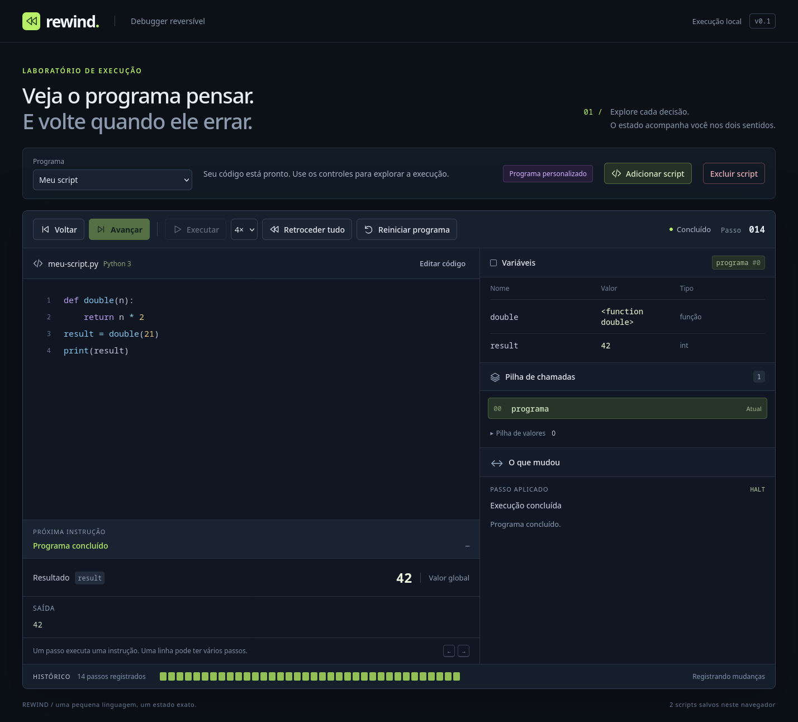
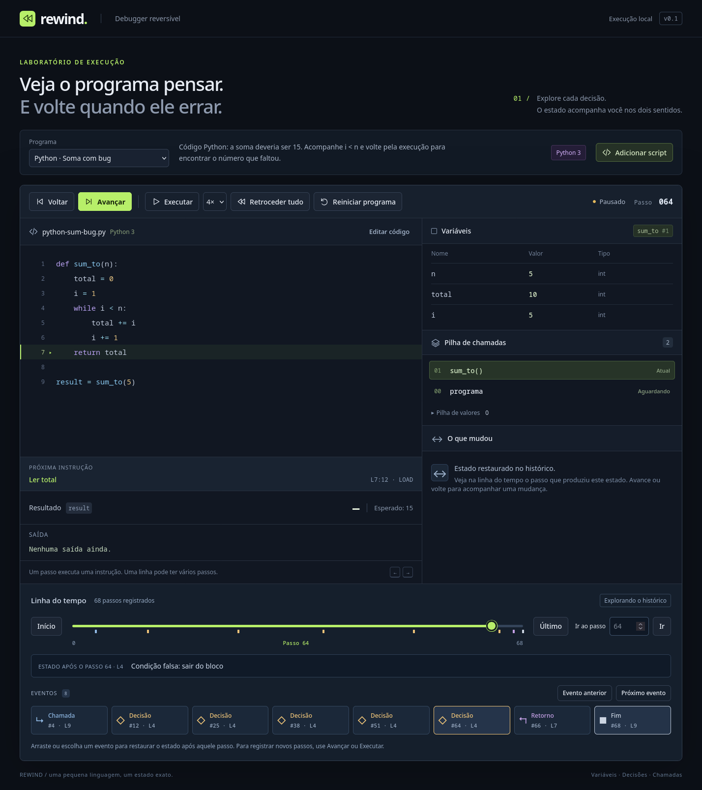
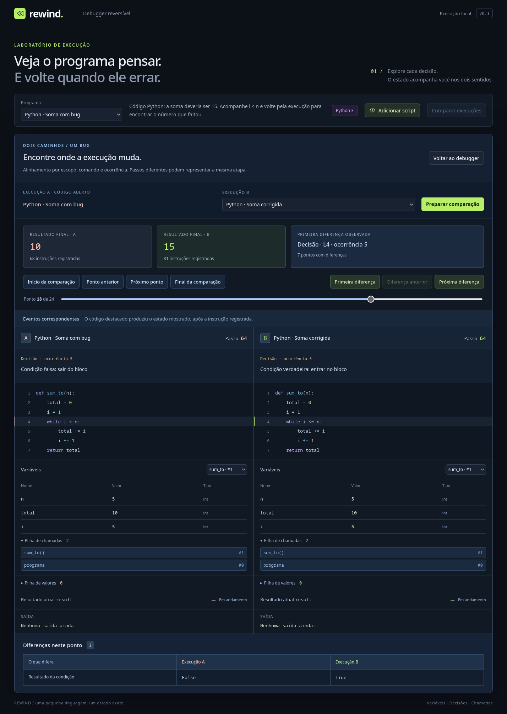
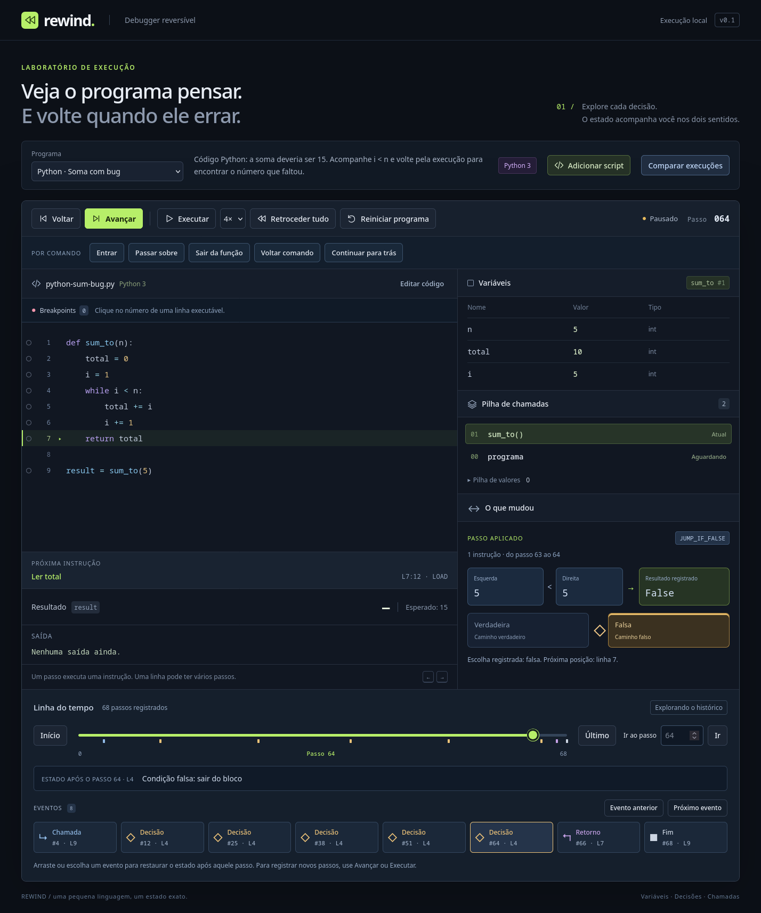
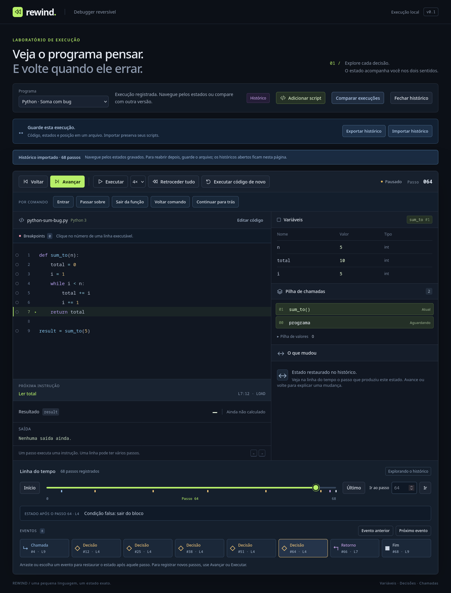
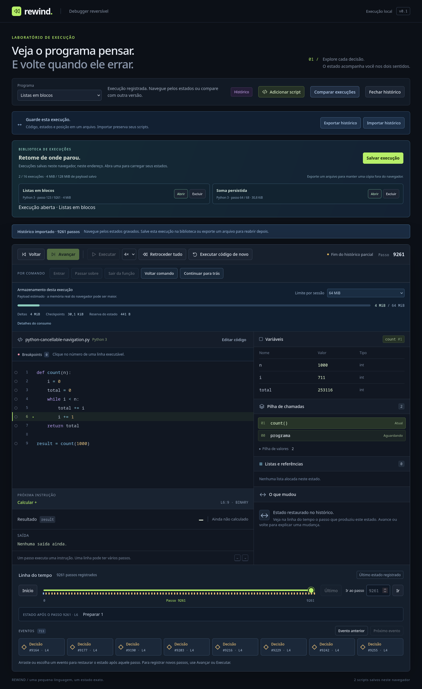
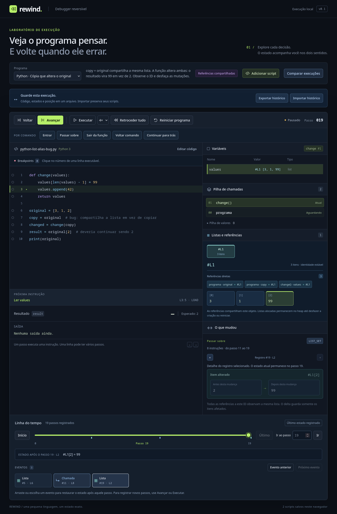
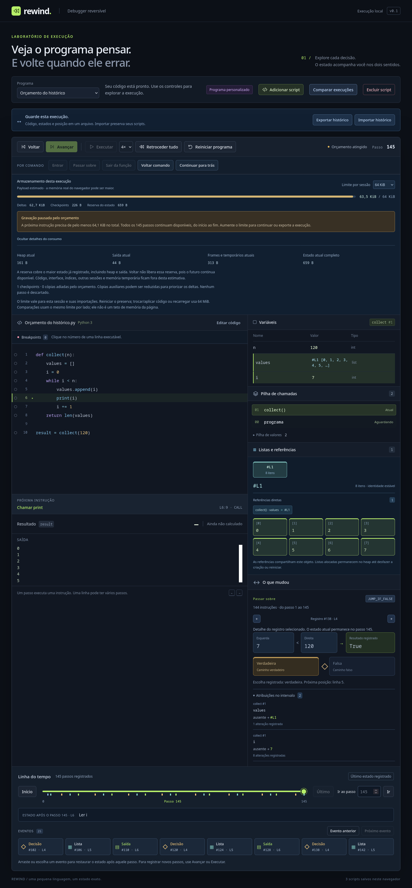
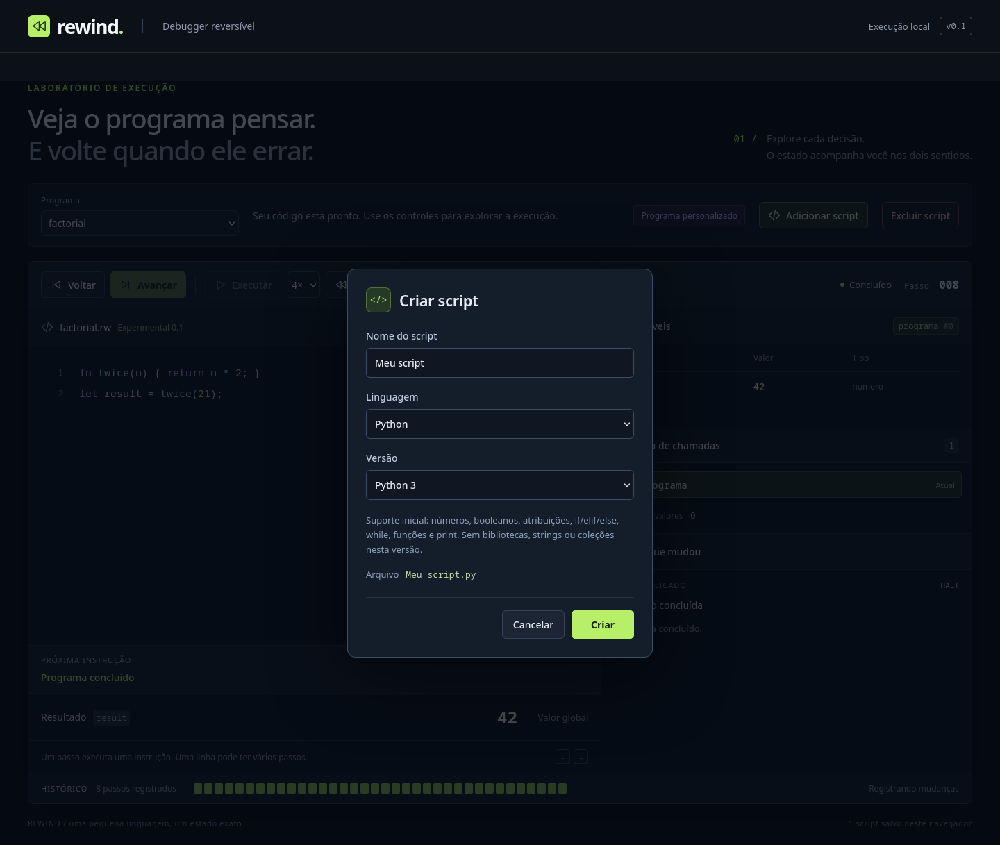

# Rewind

Debugger visual reversível implementado em TypeScript. Interpreta um subconjunto de **Python 3** e mantém os exemplos da linguagem experimental criada para a primeira demo. Permite navegar pela execução nos dois sentidos, observando variáveis, chamadas, instruções, saída e mudanças.

A linha do tempo permite saltar para qualquer passo registrado, escolher eventos e restaurar o estado exato usando deltas e checkpoints esparsos.

Breakpoints por linha e os controles **Entrar**, **Passar sobre**, **Sair da função** e **Voltar comando** permitem explorar o código por comandos. **Continuar para trás** busca o breakpoint anterior no histórico.

**Comparar execuções** mostra duas versões lado a lado, alinha seus eventos e identifica a primeira diferença observada, preservando a sessão principal.

**O que mudou** explica operações, decisões, leituras e frames com os valores registrados, também ao desfazer. Passos por comando agregam as atribuições e permitem selecionar uma instrução do intervalo sem mover o programa.

**Exportar histórico** guarda a execução num arquivo; **Importar histórico** restaura o mesmo cursor e os estados já gravados. Históricos importados também podem ser comparados sem executar o código novamente.

**Listas Python** têm identidade estável no painel **Listas e referências**. Literais, índices, `append` e `len` preservam compartilhamento entre variáveis, parâmetros e retornos, inclusive ao desfazer mutações e ciclos.

**Armazenamento desta execução** acompanha o payload reservado e permite ajustar o orçamento. A gravação pausa se a próxima instrução não couber, mantendo todos os passos para navegação e exportação.

**Salvar execução** guarda o histórico em blocos no navegador. A biblioteca preserva execuções após recarregar; **Abrir** recupera o cursor e o futuro gravado, com validação e cancelamento. Scripts continuam separados.

**Rewind é o nome do projeto.** A linguagem experimental dos arquivos `.rw` foi criada aqui; não é uma linguagem padrão. O suporte a Python tem parser e regras próprios, com limitações explícitas em [Python 3](docs/python.md).



## Rodar a demo

Requer um Node compatível com as dependências fixadas no lockfile. O projeto foi validado com **Node 24.18.0** e npm 11.16.0 já existentes nesta máquina. Nenhuma atualização global é necessária.

```bash
cd /home/IVPTER/codes/reversible-debugger
npm ci
npm run dev -- --port 5179 --strictPort
```

Abra <http://127.0.0.1:5179> no Firefox ou em outro navegador moderno. Se as dependências já estão instaladas, basta o último comando.

As dependências ficam em `node_modules/` e o cache em `.npm-cache/`, conforme `.npmrc`. Não há instalação global, fonte remota, backend ou serviço externo usado pela demo. Instalar dependências requer rede; executar a demo depois disso não requer acesso à internet.

## Experimentar

1. Mantenha o exemplo **Python · Soma com bug**.
2. Avance até `sum_to` entrar na pilha. A definição da função e a preparação do argumento também são passos.
3. Continue com **Avançar**, ou use **Executar** para reproduzir a execução.
4. O resultado é `10`, embora a soma inclusiva de 1 a 5 devesse ser `15`.
5. Volte através da atribuição de `result` e do retorno: o resultado desaparece e o frame de `sum_to` reaparece com suas variáveis.
6. Continue voltando até `i < n` comparar `5 < 5`. Avance novamente para reproduzir exatamente as mudanças registradas.
7. Escolha **Python · Soma corrigida** para executar `i <= n`, obtendo `15`.

**Retroceder tudo** desfaz os passos em lotes e restaura o estado inicial, inclusive saída, preservando o histórico para reaplicação. Trocar de exemplo ou aplicar código editado cria uma nova sessão. As teclas esquerda/direita navegam quando o foco não está em um controle de edição. Cada passo representa uma instrução da VM: uma linha do código pode exigir vários passos.

## Explorar a linha do tempo

Depois de executar o programa, arraste o controle de posição ou use **Ir ao passo** para restaurar um estado registrado. **Início** restaura o estado inicial; **Último** restaura o último estado registrado. Navegar pausa a reprodução e mantém o histórico, inclusive se a execução ainda estiver incompleta.

Os eventos mostram chamadas, retornos, decisões, listas, saída, erros e conclusão. Clique em um cartão ou use **Evento anterior** / **Próximo evento**. O destino é o estado **após** aquele passo; o código destaca a próxima instrução. O controle deslizante também aceita as teclas de seta quando está em foco.

Para investigar a soma Python com bug, execute até o resultado `10` e escolha a última **Decisão**: a condição é falsa com `i = 5`, e o programa está prestes a retornar sem somar esse número. Vá ao **Retorno** para ver a função sair da pilha; escolha a decisão novamente para recuperar seus locais. Avançar reaplica as mudanças gravadas.

Só existem destinos até o último passo registrado. Para descobrir estados novos, continue com **Avançar** ou **Executar**. Reiniciar limpa também a linha do tempo e os checkpoints, preservando os scripts salvos.

Saltos longos mostram progresso e **Cancelar navegação**. Cada lote publica um estado válido; cancelar mantém o último passo mostrado. Escolher outro destino substitui o pedido anterior, e reiniciar/trocar programa impede callbacks antigos de alterar a nova sessão. Na comparação, o ponto muda somente depois de restaurar os dois lados. [Demo, contrato e medidas](docs/cancellable-navigation.md).



## Breakpoints e comandos

Clique no número de uma linha executável para colocar um breakpoint. **Executar** para antes de seu comando; executar novamente atravessa essa passagem e permite parar na próxima iteração. **Continuar para trás** restaura a ocorrência anterior no histórico.

No exemplo Python da soma, coloque um ponto na linha **4**: a primeira pausa mostra `i = 1` e `total = 0`; a seguinte mostra `i = 2` e `total = 1`. Voltar ao breakpoint recupera os valores anteriores. A lista permite remover pontos, desativá-los temporariamente ou limpar todos. Reiniciar preserva os pontos da sessão; trocar/aplicar código ou recarregar cria uma configuração nova.

**Entrar** observa a próxima chamada; **Passar sobre** conclui o comando e suas chamadas; **Sair da função** para logo após o retorno do frame atual. Breakpoints encontrados no caminho continuam valendo. **Voltar comando** recupera o início do comando anterior na ordem do histórico. Os controles básicos continuam avançando/voltando uma instrução.

Um comando de condição para antes do próximo comando do bloco escolhido. Um retorno pode deixar a execução no meio da expressão do chamador, com temporários na pilha. [Regras completas, exemplo visual e API](docs/breakpoints-stepping.md).

## Comparar duas versões

No exemplo **Python · Soma com bug**, clique em **Comparar execuções**, mantenha **Python · Soma corrigida** como B e clique em **Preparar comparação**. Os resultados são `10` e `15`. **Primeira diferença** mostra a quinta condição: os locais ainda coincidem (`i = 5`, `total = 10`), mas A sai e B continua.

Navegue pelos pontos nos dois sentidos ou use o controle deslizante. Uma iteração extra aparece como evento exclusivo de B; os retornos são reencontrados mesmo com números de passo diferentes. A tela mostra código, variáveis por escopo, pilhas, saída, resultado e diferenças. **Voltar ao debugger** preserva a posição original.

A segunda fonte pode ser um exemplo ou um script salvo da mesma linguagem/versão. A preparação é cancelável; fontes inválidas e limites de gravação não apagam código ou a sessão aberta. O alinhamento é estrutural e automático: não prova equivalência entre programas arbitrários nem compara cada operação matemática intermediária. [Contrato, limites e API](docs/execution-comparison.md).



## Entender cada mudança

Execute a soma Python com bug, escolha a última **Decisão** e clique em **Voltar**. O diagrama mostra `5 < 5 → False` e a decisão desfeita. Volte mais uma instrução para recuperar os operandos originais da comparação; avance para reaplicar o registro. Ao desfazer um retorno, o diagrama mostra o frame restaurado e seus locais.

Nos controles por comando, consulte **Atribuições no intervalo** e as setas de **Registro**. Selecionar esse detalhe conserva o cursor atual. Variáveis e atribuições têm paginação para manter a interface utilizável com milhares de locais. Animações respeitam movimento reduzido. [Contrato, medidas e evolução do armazenamento](docs/visual-explanations.md).



## Guardar e reabrir uma execução

Navegue até o passo desejado e clique em **Exportar histórico**. O arquivo `.rewind.json` guarda fonte, runtime, deltas e cursor, incluindo o futuro já registrado. **Importar histórico** valida o arquivo em um Worker local e só então abre a sessão restaurada.

Os arquivos aparecem no grupo **Históricos importados**, inclusive no seletor da comparação. **Fechar histórico** remove a entrada carregada nesta página, preservando arquivos, execuções salvas e scripts. Recarregar fecha essas entradas; para reabrir, importe o arquivo ou abra uma captura salva na biblioteca.

Gravações parciais permitem avançar até o último registro disponível. **Executar código de novo** inicia uma execução limpa da fonte. As quotas são 32 MiB por arquivo e até 8 históricos/64 MiB abertos; excedê-las recusa a operação sem descartar dados. [Formato, garantias e medidas](docs/portable-histories.md).



**Salvar execução** abre um modal para nomear uma captura de todos os passos e da posição atual. Depois de reiniciar/recarregar, clique em **Abrir** na biblioteca para restaurá-la. **Excluir** remove somente aquela captura, com confirmação. São até 16 execuções/128 MiB de payload em IndexedDB, com checksums, gravação atômica ao publicar e carregamento cancelável em Worker. A lista usa metadados; os deltas são carregados quando você abre uma execução. [Formato, quotas, recuperação e medidas](docs/persistent-histories.md).



## Listas e referências compartilhadas

Escolha **Python · Cópia que altera o original**. `copy = original` faz os dois nomes apontarem para `#L1`; a função recebe essa mesma lista. A escrita no último item e `append(42)` mudam também `original`: o resultado é `99`, embora devesse continuar `2`.

Use **Entrar** e **Passar sobre** para observar os itens e referências no painel. **Voltar comando** desfaz a operação anterior, restaurando o item ou removendo o append; desfazer o retorno recupera o frame com a mesma referência. Selecionar uma lista ou seguir um item que aponta para outra lista mantém o cursor.

Compare com **Python · Cópia independente**, cujo resultado é `2`. **Primeira diferença** mostra a criação da segunda lista em B; **Próxima diferença** evidencia o compartilhamento em A. O exemplo **Python · Uma lista aponta para si** mostra `[...]` em `print` e permite seguir a autorreferência sem expandi-la indefinidamente.



Cada mutação guarda somente os itens removidos/adicionados. Checkpoints completos continuam esparsos. O formato de históricos agora é **v2 / rewind-vm/2**; arquivos v1 são recusados explicitamente e podem ser abertos na branch anterior `feat/portable-histories`. Scripts salvos continuam usando o mesmo formato. [Semântica, armazenamento, limites e benchmark](docs/reversible-lists.md).

## Controlar o crescimento do histórico

Escolha **Python · Crescimento do histórico**, selecione **64 KiB** no painel de armazenamento e use **Entrar**, depois **Passar sobre**. A gravação pausa dentro de `collect`, preservando lista, variáveis, pilha e saída. **Início** e **Último** continuam disponíveis; o consumo reservado não cai ao voltar, porque o futuro ainda está guardado.

Selecione **4 MiB**, use **Sair da função** e **Executar** para concluir com `120`, sem duplicar passos ou saída. O padrão é **até 64 MiB por sessão**, ajustável até 256 MiB conforme a reserva disponível na página. Reiniciar conserva o limite; trocar/aplicar código ou recarregar restaura o padrão disponível, preservando os scripts. A página reserva até **256 MiB de payload** entre sessões abertas e VMs temporárias; esses valores não medem RAM real.



O total conta deltas, checkpoints e uma reserva para o maior estado observado, incluindo heap e saída. É uma estimativa de payload UTF-8, não memória real do navegador ou teto agregado da página. Checkpoints auxiliares podem diminuir para priorizar os deltas; saltos longos ficam mais caros. Importações/comparações respeitam o orçamento local. [Contrato, API, medidas e próximos limites](docs/storage-budget.md).

## Usar seu próprio script

1. Clique em **Adicionar script**. O modal pede, nessa ordem, **Nome do script**, **Linguagem** e **Versão**.
2. Escolha **Python / Python 3** ou **Experimental da demo / 0.1** e clique em **Criar**. O script aparece vazio no editor, com o nome escolhido e uma execução limpa. Cancelar ou pressionar Escape preserva o programa anterior.
3. Cole o código ou use **Importar arquivo** para carregar `.py`, `.rw` ou `.txt`. Arquivos `.py` e `.rw` selecionam a linguagem correspondente automaticamente; o nome do script criado é preservado.
4. Confira o contador de caracteres e clique em **Aplicar código**. Erros preservam a sessão anterior e o rascunho para correção.
5. Use **Executar**, **Voltar** e **Retroceder tudo**. `print` aparece no painel **Saída** e também é desfeito ao retroceder.

Os scripts criados ficam no grupo **Seus scripts** do seletor de programas. O código em edição é salvo automaticamente no navegador, inclusive se ainda tiver erros de sintaxe. Ao recarregar a página, a seleção e o código são restaurados e uma execução nova é preparada. Rascunhos inválidos são reabertos no editor para correção. A importação continua preservando o rascunho anterior quando rejeita um arquivo.

**Reiniciar programa** limpa o estado da execução e o histórico, mantendo o código e todos os scripts salvos. **Retroceder tudo** preserva o histórico para reaplicação. Para limpar a lista, selecione um script e clique em **Excluir script**: a confirmação identifica o nome e remove apenas esse script do navegador; os outros ficam guardados. Arquivos importados no computador não são apagados.

O armazenamento usa o navegador e o endereço em que a demo foi aberta, sem backend ou sincronização com o GitHub. Apenas código, nome, linguagem, versão e seleção são guardados; frames e histórico de execução não são persistidos. Falhas de armazenamento aparecem na interface. Nenhuma gravação sobrescreve dados que a aplicação não conseguiu ler.



O limite passou de 50.000 para **1.000.000 de caracteres**, tanto no editor quanto na importação e no núcleo. A tela renderiza apenas as linhas próximas ao trecho visível, inclusive quando o programa tem milhares de linhas. O seletor oferece apenas versões realmente implementadas: Python 3 e Experimental 0.1. JavaScript ainda não está implementado.

Outros exemplos: fatorial recursivo (`120`), algoritmo de Euclides (`6`) e divisão por zero. No último, voltar desfaz o erro e restaura os operandos da divisão.

## Estrutura

```text
src/core/language.ts   Lexer, parser, AST e posições no código
src/core/python.ts     Parser Python, indentação e posições originais
src/core/python-values.ts  Regras de valores e operações Python
src/core/heap.ts       Objetos de lista, referências, índices e limites
src/core/heap-comparison.ts  Comparação de conteúdo e compartilhamento
src/core/runtime.ts    Linguagens, versões e apresentação dos valores
src/core/compiler.ts   Instruções, funções e metadados de origem
src/core/machine.ts    Estado explícito, transações e deltas
src/core/history.ts    HistoryStore, checkpoints e política de retenção
src/core/storage-accounting.ts  Payload incremental, estado atual e reserva
src/ui/useHistorySeek.ts  Pedidos, lotes, progresso e cancelamento da navegação
src/core/history-events.ts  Eventos projetados das transações
src/core/debugger.ts   Sessão, cursor, passos e busca por posição
src/core/execution-control.ts  Breakpoints, planos em lotes e passos por comando
src/core/comparison*.ts  Execuções isoladas, pontos, alinhamento e diferenças
src/core/explanations.ts  Evidências dos deltas e resumos de intervalos
src/core/portable-history.ts  Codec versionado, quotas e identidade de arquivos
src/core/trace-validation.ts  Esquema, precondições dos deltas e cadeia de estados
src/workers/           Parsing/validação local e envio de registros em lotes
src/ui/               Interface React e estilos responsivos
examples/             Programas .py e .rw usados pela demo e pelos testes
tests/core.test.ts    Semântica, reversibilidade e propriedades geradas
tests/history.test.ts Busca exata, checkpoints, eventos e navegação gerada
tests/execution-control.test.ts  Paradas, recursão, agrupamento e replay
tests/comparison.test.ts  Divergência, alinhamento e restauração das duas sessões
tests/explanations.test.ts  Proveniência, escopos, undo e índice incremental
tests/portable-history.test.ts  Round trip, corrupção, quotas, forks e comparação
tests/lists.test.ts   Heap, aliases, ciclos, mutações, codec e reversibilidade
tests/storage-budget.test.ts  Fronteiras, rollback, reserva, retomada e quotas
tests/cancellable-navigation.test.ts  Lotes exatos, abort, pedidos antigos e pares
tests/browser/        Fluxos Playwright para múltiplos engines
scripts/              Teste com Firefox instalado e launcher Playwright
docs/                 Arquitetura, linguagem e etapas futuras
```

O núcleo não depende de React, DOM ou navegador. Ele também pode ser usado em Node:

```ts
import { DebugSession } from './src/core/debugger';

const session = new DebugSession('let result = 2 + 3;');
session.forward();
session.backward();
session.forward(); // Reaplica o registro existente.
console.log(session.state, session.cursor);
```

Para Python, informe o runtime:

```ts
const session = new DebugSession('result = 2 + 3\nprint(result)', {
  language: 'python',
  version: '3',
});
```

Para gravar e buscar posições usando checkpoints:

```ts
const session = new DebugSession('result = 2 + 3\nprint(result)', {
  language: 'python', checkpointInterval: 128, maxCheckpoints: 128,
});
while (session.canForward) session.runBatch();
session.seek(0);                      // Restaura o estado inicial.
session.seek(session.history.length); // Recupera resultado e saída sem reexecutar.
console.log(session.historyStats);    // Intervalo atual e cursores dos checkpoints.
```

## Verificações

```bash
npm run check         # TypeScript + testes do núcleo
npm run build         # TypeScript + build estático em dist/
npm run test:firefox  # Firefox instalado, sem baixar outro navegador
npm run bench:history # Payload e latência: deltas, checkpoints e snapshots
npm run bench:visual  # Explicações, lotes, índice e navegação com 18–19 mil passos
npm run bench:portable # Arquivos, importação/exportação, forks e atrasos de timer
npm run bench:heap    # Mutação por item, busca exata e custo dos checkpoints
npm run bench:storage # Orçamento, checkpoints reduzidos, busca e retomada
npm run bench:navigation # Lotes, latência total e heartbeat em saltos longos
npm run test:firefox -- --reduced-motion # Perfil isolado com animações desativadas
```

`test:firefox` usa o executável `firefox` disponível no PATH. É possível escolher outro caminho com `FIREFOX_BIN`. Abre uma instância headless separada com `--no-remote` e perfil próprio em `.artifacts/`, usando WebDriver BiDi. Não usa o perfil pessoal, geckodriver ou um navegador fornecido pelo Playwright. O servidor e a instância de teste são encerrados ao final; screenshots e log ficam em `.artifacts/`. Se a porta local 5178 ou 9238 estiver ocupada, encerre o processo de teste conflitante; `REWIND_BIDI_PORT` permite escolher a segunda porta.

O ambiente precisa permitir executar o Firefox e abrir portas locais. O teste depende do protocolo disponível em versões recentes do Firefox. Referência: [conexão WebDriver BiDi na documentação da Mozilla](https://developer.mozilla.org/en-US/docs/Web/WebDriver/How_to/Create_BiDi_connection).

Para ambientes que **já tenham os browsers de teste do Playwright** no diretório local `.playwright-browsers/`:

```bash
npm run test:e2e -- --project=firefox
npm run test:e2e -- --project=chromium
npm run test:e2e -- --project=webkit
npm run test:e2e -- --project=mobile-webkit
```

Esses comandos não baixam navegadores automaticamente. O Firefox comum instalado na máquina é usado por `test:firefox`; os projetos Playwright requerem seus próprios builds de teste. Nesta entrega, Chromium e WebKit estão configurados, mas não foram executados, para respeitar a preferência de não baixar browsers.

### O que os testes comprovam

- Resultados conhecidos, precedência, escopos lexicais, recursão e chamadas dentro de expressões.
- Estado completo igual após desfazer cada instrução e após reaplicá-la, inclusive temporários, identificadores e pontos de retorno.
- Erros atômicos e reversíveis; declarações removidas ao voltar; preservação de `-0`.
- Sequências geradas de navegação e programas de soma com limites e incrementos variados, com seeds reproduzíveis.
- Limites de histórico e chamadas sem perder a possibilidade de voltar.
- Deltas de atribuição cujo tamanho não acompanha a quantidade de outras variáveis.
- No Firefox: execução do bug, chamadas, retorno, reinício, replay, exemplo corrigido, erro reversível, edição, layout de 390 px sem overflow e ausência de erros no console.
- Python: inteiros exatos, divisão inteira e resto com sinais, precedência de potências, escopos locais, definição de funções em ordem e curto-circuito. Uma verificação opcional compara os valores/tipos com o Python instalado, sem instalar ou atualizar esse runtime.
- No Firefox: importação `.py`, linguagem/versão, execução e desfazimento de `print`, retrocesso completo, arquivo de 10.001 linhas e preservação do rascunho ao rejeitar um arquivo acima do limite.
- No Firefox: modal com foco no nome, cancelamento por Escape, criação vazia sem estado antigo, reinício do programa, recarga imediata com código em edição, recuperação de código incompleto e exclusão com confirmação sem remover outros scripts.
- Busca de cada cursor comparada com a referência sequencial nos dois runtimes; chamadas recursivas, controle, operandos, saída, erros, `bigint`, `-0`, infinitos e `NaN` restaurados exatamente.
- Checkpoints isolados, retenção limitada, continuidade após restauração, descarte no reinício e nenhuma chamada ao executor durante saltos; navegação gerada com seed reproduzível.
- No Firefox: linha do tempo, range com teclado, salto numérico, eventos, frames, resultado, saída e erro restaurados, pausa ao navegar e histórico preservado.
- Breakpoints antes dos comandos, retomada por ocorrência, busca reversa, loops vazios, comandos na mesma linha e cabeçalhos multilinha.
- Entrar/passar sobre/sair em chamadas aninhadas e recursivas, temporários preservados, retorno implícito, saída desfeita ao voltar comando e estados completos iguais aos da referência.
- No Firefox: controles por comando, breakpoint no loop, retomada, ocorrência anterior, replay parcial, preservação dos pontos no reinício, desativação/remoção e layout móvel.
- Comparação: quinta decisão divergente, iteração extra, retorno com cursores diferentes, linhas/endereços deslocados, recursão e IDs de frames após chamadas adicionais.
- Restauração de todos os campos de ambas as sessões em cada ponto, saltos gerados, valores especiais, saída, erros e limites; navegação não reexecuta instruções.
- No Firefox: comparação dos exemplos e scripts salvos, primeira diferença, eventos exclusivos, saída, versões iguais, teclado, cancelamento, fonte inválida, layout móvel e sessão principal preservada.
- Explicações sem executor/matemática, ordem dos operandos, proveniência por índices, escopos históricos, frames restaurados, valores especiais e ausência de bindings.
- No Firefox: diagramas nos dois sentidos, seleção de registro sem mover o cursor, movimento normal/reduzido, ~18 mil passos, 2.502 locais restaurados, paginação e limites de DOM.
- Arquivos: estado completo em todos os cursores dos exemplos, valores especiais, nomes de propriedades, corrupção/versões, quotas, cancelamento, checkpoints e forks isolados. Comparar/importar/reaplicar registros não chama o executor.
- No Firefox: download local, importação no mesmo cursor, futuro preservado, comparação de arquivos, parcial/conclusão distintos, Worker cancelado ao trocar programa e importação de 18 mil passos com 2.502 locais sem remover scripts.
- Listas: referências compartilhadas, listas aninhadas/cíclicas, índices negativos/bool, ordem de avaliação, erros atômicos, limites, checkpoints/forks isolados e restauração de todos os campos em cada cursor. Comparação opcional de saída com o Python instalado.
- No Firefox: mutações e append nos dois sentidos, retorno com referência, comparação 99/2, ciclo, importação v2, rejeição v1 sem perder a sessão, lista de 3.000 itens paginada e layout móvel.
- Orçamento: fronteira exata, recusa atômica de instruções, contadores incrementais, reserva estável, checkpoints reduzidos, navegação gerada, retomada, reinício, forks, importação/comparação e ausência de varredura completa por instrução.
- No Firefox: pausa em 64 KiB, futuro/consumo preservados, exportação parcial, importação recusada sem perder scripts, limite ampliado com resultado 120, reinício/recarga e layout móvel.
- Navegação: estado exato em cada lote, cancelar/substituir destinos, AbortSignal, callback obsoleto após ações manuais/reinício, importação interrompida e publicação atômica dos dois lados da comparação.
- No Firefox: salto de milhares de passos com heartbeat/renderização, cancelamento no estado intermediário, destino substituído, troca/reinício sem callbacks antigos e comparação preservada.
- IndexedDB: reversibilidade ao reabrir, captura consistente, quotas entre abas, recuperação de gravações interrompidas, versões/corrupção, exclusão isolada, builders privados e orçamento agregado de payload.
- No Firefox: salvar/recarregar/abrir no cursor original, futuro e comparação preservados, 9.261 passos em 37 blocos, gravação/leitura cancelável, troca sem callbacks antigos, scripts intactos e layout móvel.

Snapshots **por passo** existem apenas como referência nos testes e no benchmark. O histórico de produção armazena deltas e checkpoints completos ocasionais. Testes de ida e volta verificam reversibilidade; os testes com resultados conhecidos verificam a semântica, pois um interpretador incorreto também pode ser reversível.

## Documentação

- [Biblioteca persistida em blocos, quotas e recuperação](docs/persistent-histories.md)
- [Arquitetura e decisões](docs/architecture.md)
- [Especificação da linguagem](docs/language.md)
- [Python 3: recursos e limitações](docs/python.md)
- [Etapas e próximos marcos](docs/roadmap.md)
- [Medidas e política de checkpoints](docs/history-performance.md)
- [Breakpoints e controles por comando](docs/breakpoints-stepping.md)
- [Comparação entre execuções](docs/execution-comparison.md)
- [Explicações visuais e escala](docs/visual-explanations.md)
- [Históricos portáveis](docs/portable-histories.md)
- [Listas e heap reversível](docs/reversible-lists.md)
- [Orçamento do histórico](docs/storage-budget.md)
- [Navegação cancelável](docs/cancellable-navigation.md)

Limites atuais: 1.000.000 de caracteres, 128 níveis de aninhamento sintático, 20.000 passos registrados por sessão e 256 frames incluindo o global. Python limita literais inteiros a 4.300 dígitos, cálculos a 100.000 bits, heap a 4.096 listas/20.000 itens totais e cada `print` a 100.000 caracteres. A interface usa lotes limitados para devolver o controle ao navegador, inclusive nos saltos. Checkpoints começam a cada 128 passos, com teto de 128 cópias e espaçamento adaptativo, respeitando também o orçamento de payload (até 64 MiB por padrão). Arquivos/execuções salvas têm teto de 32 MiB, até 8 históricos/64 MiB abertos e biblioteca de até 16 execuções/128 MiB; essas medidas não são heap JavaScript. O próximo marco é um histórico paginado sob demanda, com cache e checkpoints persistidos, antes de ampliar sessões.
