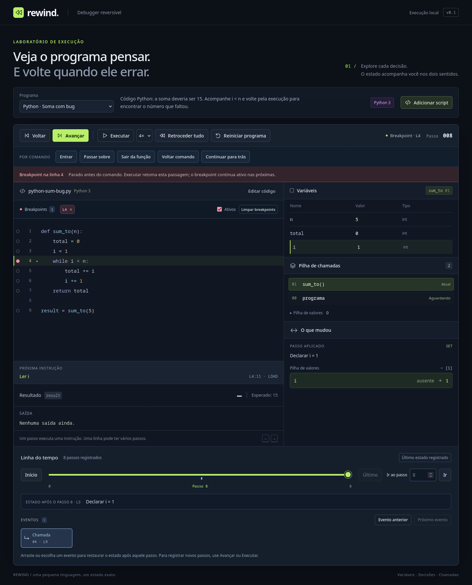

# Breakpoints e passos por comando

O histórico continua guardando cada instrução. Estes controles escolhem onde parar nessa sequência, preservando estados, checkpoints e saída reversível.

## Usar na demo

No exemplo **Python · Soma com bug**, clique no número **4**, onde começa `while i < n`, e depois em **Executar**. A pausa ocorre antes de ler `i` ou avaliar a condição: o primeiro estado tem `i = 1` e `total = 0`.

Clique novamente em **Executar**. O debugger atravessa essa passagem e para na seguinte, com `i = 2` e `total = 1`. **Continuar para trás** recupera a ocorrência anterior, incluindo locais, controle e pilhas. Repetir Executar nesse estado reaplica os mesmos registros.

Os círculos na margem identificam linhas elegíveis; o círculo preenchido marca um breakpoint. Clique novamente para removê-lo, use os botões **L4 ×** da lista ou **Limpar breakpoints**. A opção **Ativos** desabilita as paradas sem remover os pontos. Reiniciar o programa preserva essa configuração na sessão atual.



## Significado dos controles

| Controle | Destino |
|---|---|
| Avançar / Voltar | Uma instrução aplicada/desfeita, mesmo em uma linha com breakpoint |
| Executar | Próximo breakpoint, erro ou conclusão; permite pausar |
| Entrar | Próximo comando ou entrada/retorno de uma função |
| Passar sobre | Próximo comando do frame atual, concluindo chamadas; se esse frame retornar, para na continuação do chamador |
| Sair da função | Continuação do chamador imediatamente depois do retorno do frame atual |
| Voltar comando | Entrada anterior de comando na ordem cronológica do histórico |
| Continuar para trás | Breakpoint anterior no histórico, ou o estado inicial |

**Passar sobre** em `if` ou `while` avalia a condição e para no próximo comando escolhido pelo fluxo. Não executa todo o bloco ou todas as iterações de uma vez. Dois comandos distintos na mesma linha continuam sendo dois passos por comando. Em uma atribuição multilinha, o breakpoint pertence ao cabeçalho da atribuição.

**Entrar** em `result = 10 + double(double(3))` observa primeiro a chamada que calcula o argumento, depois seu retorno e a chamada externa. **Passar sobre** nessa atribuição conclui as chamadas e a atribuição antes de parar. **Sair da função** para assim que o frame retorna, mesmo se ainda faltar uma operação ou atribuição na expressão do chamador: os temporários permanecem visíveis na pilha de valores.

**Voltar comando** segue a execução gravada. Se o último comando executado foi um `return` dentro de uma chamada, voltar restaura esse comando e seu frame. Ele não desfaz uma ação anterior de Passar sobre como um bloco indivisível. Cada instrução intermediária permanece acessível pelos controles básicos e pela linha do tempo.

## Regras de parada

Um breakpoint para antes da primeira instrução do comando. Retomar com Executar ignora somente a posição em que ocorreu a pausa, permitindo atravessá-la uma vez. A próxima iteração, chamada recursiva ou outro comando na mesma linha pode parar novamente. Passos manuais para frente atravessam o ponto atual, mas Entrar/Passar sobre/Sair respeitam breakpoints encontrados no caminho.

Continuar para trás desfaz pelo menos uma instrução antes de procurar um ponto. O destino é o mesmo estado anterior ao comando encontrado ao avançar. Não existe busca por estados anteriores ao início, nem previsão de estados que ainda não foram registrados.

Pausar ou navegar manualmente cancela o plano. Depois de um breakpoint interromper Passar sobre ou Sair, o usuário escolhe uma ação nova a partir do frame agora ativo. Erros da VM encerram o plano com estado de erro reversível; limites de histórico também interrompem a ação e preservam as transações já concluídas.

Linhas vazias, comentários, delimitadores e `pass` não têm instrução própria nesta linguagem pequena e não recebem breakpoint. Um retorno implícito pode ser observado com Entrar/Sair, sem inventar uma instrução executável para o `pass`.

Os pontos pertencem ao programa compilado atual. Reiniciar mantém os pontos; trocar programa, aplicar código ou recarregar cria outra configuração. Os scripts salvos continuam preservados. Breakpoints condicionais e persistência dos pontos entre sessões ficam fora desta entrega.

## API do núcleo

```ts
import { DebugSession } from '../src/core/debugger';
import { ExecutionControl } from '../src/core/execution-control';

const session = new DebugSession('i = 0\nwhile i < 3:\n    i += 1\nresult = i', {
  language: 'python',
});
const control = new ExecutionControl(session);
control.toggleBreakpoint(2);
control.start('continue');
while (control.running) control.runBatch(100);
console.log(control.stop, session.state); // Antes da primeira condição.

control.start('continue'); // Retoma esta ocorrência e busca a seguinte.
while (control.running) control.runBatch(100);

control.start('reverse-continue');
while (control.running) control.runBatch(100);

// Cancele antes de navegar diretamente na sessão.
control.cancel();
session.seek(0);
```

`runBatch` aceita de 1 a 1.000 transações e informa direção, origem, quantidade percorrida, última instrução e parada. Uma ação longa continua no próximo lote; a UI devolve o controle ao navegador entre eles. `canStepOut` indica se existe um frame de função ativo. IDs de frames, em vez de apenas profundidade, distinguem o frame original de suas chamadas recursivas.

## Controles no modo paginado/contínuo

Os mesmos breakpoints e passos por comando estão disponíveis diretamente em **Abrir**, **Gravar sessão** e **Retomar**, com política compartilhada, lotes de até 16 e fronteira parcial explícita. [Contrato, demo e testes](paged-controls.md). A explicação paginada corresponde à última instrução do lote; o debugger completo oferece a agregação por comando.
