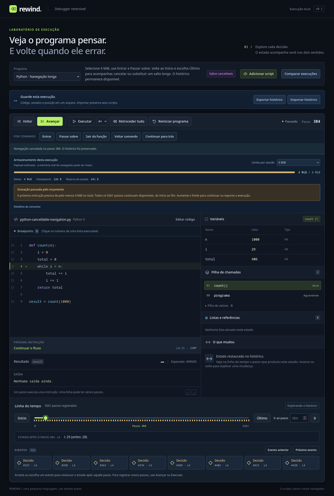

# Navegação cancelável

Saltos da linha do tempo agora restauram estados em lotes, mostrando progresso quando exigem mais de um lote. É possível cancelar, escolher outro destino ou usar outro controle entre os lotes. Cada cursor mostrado corresponde a uma transação completa do histórico.



## Experimentar

1. Escolha **Python · Navegação longa**, selecione **4 MiB** e use **Entrar**, depois **Passar sobre**. O orçamento pausa a gravação com milhares de passos e poucos checkpoints.
2. Use **Início**, depois **Último**. O painel mostra destino, cursor atual e registros restaurados.
3. Clique em **Cancelar navegação**. O estado permanece no último cursor válido mostrado; o futuro continua disponível e o orçamento reservado permanece igual.
4. Escolha outro passo durante um salto. O último pedido substitui o anterior, incluindo ao arrastar o range ou usar eventos.
5. Reiniciar ou trocar de programa cancela o pedido. Um timer antigo não pode restaurar a execução anterior.

Avançar, voltar, controles por comando, edição, exportação/importação e comparação interrompem o salto em andamento antes de agir sobre o estado atual. Saltos curtos terminam no primeiro lote, sem exibir progresso. Cancelar um salto não desfaz os lotes já mostrados nem modifica o programa, histórico ou quota.

Na comparação, a regra é diferente para preservar um par consistente: ambos os destinos são preparados em VMs privadas. Somente quando os dois terminam o novo ponto é publicado. Cancelar mantém o ponto e os dois estados anteriores; um resultado intermediário de A nunca é mostrado como se estivesse alinhado com B.

## Contrato do núcleo

`DebugSession.beginSeek(target)` valida o destino, escolhe o estado atual/checkpoint próximo e cria um ID de pedido. A cópia de checkpoint também corresponde a um cursor registrado. `seekBatch(id, size, maxMilliseconds)` aplica somente deltas existentes, sem executor ou nova admissão por bytes. O padrão é até **128 transações ou 6 ms** por lote. Retorna progresso imutável ou `null` se o pedido foi substituído/cancelado.

`cancelSeek(id)` não cancela um pedido mais novo. Passos manuais, busca síncrona, orçamento e reinício invalidam IDs anteriores. Destinos/opções inválidos são rejeitados antes de alterar a posição ou o pedido válido. `seekAsync` aceita `AbortSignal`, callback de progresso e yield injetável; abort/substituição rejeitam com `AbortError`, conservando o último estado válido. A restauração final de uma importação também usa essa API em lotes, antes de publicar a sessão.

```ts
const controller = new AbortController();
await session.seekAsync(target, {
  signal: controller.signal,
  batchSize: 128,
  maxMilliseconds: 6,
  onProgress: progress => console.log(progress.cursor, progress.to),
});
// controller.abort() pode ser chamado por outro evento entre os lotes.
```

Para integração com outro agendador:

```ts
let progress = session.beginSeek(target);
while (!progress.done) {
  progress = session.seekBatch(progress.id)!;
  // Publique progress/current state e devolva controle antes do próximo lote.
}
```

`seek(cursor)` e `seekRow(index)` permanecem síncronos para consumidores antigos, testes e benchmarks. A interface usa as APIs de lotes. `forkForSeek(target)` compartilha programa/payloads congelados e começa de uma cópia próxima do alvo, evitando copiar a VM atual e depois outro checkpoint. Seu cursor inicial pode diferir do alvo, que deve ser alcançado pela navegação.

`ExecutionComparison.beginSeekRow`/`seekRowBatch` preparam sessões por lado, intercalando deltas e publicando ambas atomicamente. Cancelamento descarta essas VMs privadas. Gravação/análise da comparação também devolvem controle por contagem/tempo; saltos internos da análise usam a mesma preparação em pares. `useHistorySeek` mantém um timer por pedido, confere identidade e cancela ao trocar/desmontar a sessão.

## Limites reais

6 ms é um alvo cooperativo. Cópia de checkpoint, uma transação individual, cálculos de diferenças, alinhamento e renderização continuam indivisíveis. Uma dessas operações pode passar do alvo; não há promessa de tempo real ou transferência da VM inteira para Worker neste marco. Timers acrescentam latência total, em troca de permitir entrada, atualização da página e cancelamento.

Os limites existentes de 20.000 passos, 256 frames, heap e orçamento por sessão permanecem. Navegação por si só não grava novos deltas em IndexedDB. Os marcos seguintes acrescentaram **Salvar execução**, a [biblioteca em blocos](persistent-histories.md) e [paginação sob demanda](paged-history.md) com checkpoints auxiliares persistidos. Scripts continuam separados e arquivos v2 permanecem compatíveis. Gravação paginada e medidas vêm antes de ampliar sessões.

## Verificações e medidas

```bash
npm run check
npm run build
npm run test:firefox
npm run bench:navigation -- --output docs/navigation-benchmark.json
```

Testes do núcleo verificam todos os campos em cada lote, referências/ciclos, frames e saída, cancelamento, último pedido vencedor, IDs obsoletos, ações manuais, reinício, orçamento, opções inválidas, limite de tempo, AbortSignal, yields, importação cancelada e publicação dos dois lados. Navegação gerada usa seed `20261014`; spies garantem ausência de executor durante replay.

No Firefox instalado, a demo gravou 9.261 passos em 4 MiB. O teste observou dois heartbeats e duas oportunidades de renderização antes de cancelar no passo 384, confirmou posição estável depois de 150 ms e verificou outro destino, troca/reinício, par da comparação, orçamento/histórico preservados e console sem erros. A posição de cancelamento varia conforme agendamento; não é uma constante do algoritmo. [Registro do navegador](navigation-browser.json).

[Diagnóstico do núcleo](navigation-benchmark.json), Node 24.18.0, orçamento 2 MiB, lista de 2.000 itens, 4.301 passos e apenas checkpoint inicial. Vinte destinos foram comparados com uma execução independente; snapshots somente nesses destinos.

| Medida | p95 | Máximo | Amostras |
| --- | ---: | ---: | ---: |
| Seek síncrono completo | 23,481 ms | 23,481 ms | 20 |
| Lote cooperativo | 1,608 ms | 7,394 ms | 205 |
| Preparação/checkpoint inicial | 0,064 ms | 0,064 ms | 20 |
| Salto cooperativo completo, com timers | 59,804 ms | 59,804 ms | 20 |

Houve 186 yields e 186 heartbeats. Tempos excluem as asserções finais e não incluem DOM ou medição de RAM. Um lote excedeu 6 ms, reforçando o limite cooperativo. Esses números são diagnósticos locais, não SLA nem garantia para outros programas/hardware.
