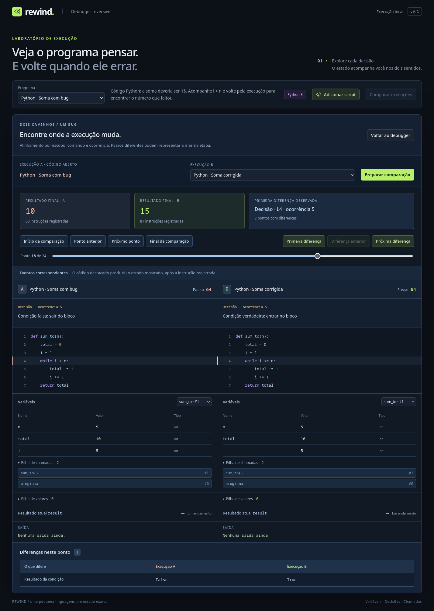

# Comparação entre execuções

Esta entrega compara duas fontes da mesma linguagem e versão, executadas em sessões próprias com estado inicial vazio. A execução que estava aberta no debugger fica pausada, com seu código, estado, cursor e histórico preservados. Comparar não modifica a biblioteca de scripts.

## Experimentar

1. Selecione **Python · Soma com bug** e clique em **Comparar execuções**.
2. A segunda versão sugerida é **Python · Soma corrigida**. Clique em **Preparar comparação**.
3. Os resultados registrados são `10` e `15`, com 68 e 81 instruções.
4. Clique em **Primeira diferença**. Ambas as versões estão na quinta avaliação da condição: `i = 5` e `total = 10`. A decide sair (`False`); B decide continuar (`True`).
5. **Próximo ponto** mostra uma atribuição somente em B. A permanece no estado da decisão enquanto B soma o número que faltava.
6. Continue até o retorno: os eventos correspondem, mas seus números de passo são diferentes. **Final da comparação** mostra os valores finais.
7. Volte pelos pontos ou arraste o controle de posição. As duas sessões recuperam exatamente os estados gravados, sem repetir a execução.
8. **Voltar ao debugger** retorna à posição que estava aberta antes de comparar.



A execução A usa o código compilado que está aberto. A execução B pode ser um exemplo ou um script salvo compatível, inclusive o mesmo script. Para comparar duas versões próprias, crie dois scripts e escolha um deles como B. Apenas fontes da mesma linguagem e versão aparecem no seletor.

## Ler a tela

**Ponto** é uma etapa da comparação; **Passo** é o cursor de instruções de cada execução. Os números de passo não precisam coincidir. O código destacado produziu o estado mostrado, depois daquela instrução, enquanto o debugger principal destaca a próxima instrução.

Um ponto corresponde a atribuição, decisão de fluxo, entrada/retorno de função, saída ou término. **Eventos correspondentes** possuem a mesma âncora e ocorrência dentro de um contexto de chamada correspondente. **Somente A/B executou este evento** identifica um evento exclusivo; o outro lado mantém seu último estado representado até reencontrar uma etapa comum.

Os cartões superiores mostram os resultados ao terminar ou parar a gravação. Os painéis de cada execução mostram o **resultado atual** do ponto selecionado, que pode ainda estar ausente. Variáveis podem ser inspecionadas por escopo; as tabelas de variáveis e diferenças são paginadas para evitar milhares de linhas simultâneas no DOM. Os trechos de código montam no máximo sete linhas por lado.

**Primeira diferença**, **Diferença anterior** e **Próxima diferença** navegam entre pontos divergentes. A tabela compara decisões, bindings/valores/tipos, pilhas, saída e situação da execução. Uma diferença de tipo entre inteiro e float, a distinção entre `-0.0` e `0.0`, ou uma variável ausente também é observável. `NaN` igual a `NaN` é tratado como o mesmo valor armazenado, sem usar a regra de igualdade aritmética do Python.

Saltos longos mostram progresso e **Cancelar navegação**. Ambos os estados são preparados em VMs privadas e publicados juntos; cancelar mantém o ponto/par anterior. Selecionar outro destino substitui o pedido. Gravação/análise também devolvem controle entre lotes. [Contrato cooperativo e limites das operações individuais](cancellable-navigation.md).

## Como o alinhamento funciona

Listas acrescentam pontos de alocação/mutação e um inspetor de heap em cada lado. A comparação associa objetos a partir das variáveis e operandos correspondentes, preservando uma correspondência bijetiva entre referências. IDs numéricos distintos não bastam para marcar divergência; itens, comprimentos, ciclos e compartilhamento são comparados. Objetos sem referências nos escopos/operandos correspondentes não influenciam essa comparação.

Nos exemplos **Python · Cópia que altera o original** / **Python · Cópia independente**, os resultados são 99/2. A primeira diferença é a criação extra da cópia em B; a próxima evidencia os aliases. Se o compartilhamento impede uma associação, a tabela indica o conflito e os pares já associados, sem inventar correspondência de todos os itens. [Contrato e benchmark do heap](reversible-lists.md).

O compilador produz âncoras estruturais por escopo, bloco, tipo/alvo e ocorrência do comando. Comentários e linhas adicionais não mudam essas âncoras. O cabeçalho do loop permanece correspondente quando `i < n` vira `i <= n`.

Cada evento acrescenta sua fase, ocorrência dinâmica e contexto de chamada. O contexto considera o pai e o local/ocorrência da chamada, distinguindo recursão e chamadas repetidas. Ele não depende dos IDs numéricos da VM, que podem mudar depois de uma chamada extra em uma versão.

O alinhamento mantém a ordem de ambas as sequências e representa cada evento uma vez. Eventos exclusivos ficam entre os pontos comuns; um retorno pode ser reencontrado depois de uma iteração extra. Dentro de um intervalo com eventos exclusivos nos dois lados, a ordem apresentada é uma convenção de exibição, não uma afirmação de simultaneidade.

Início e término são âncoras comuns. O término pode representar conclusão, erro ou limite da gravação; esses motivos diferentes aparecem na comparação dos estados.

Os pontos contêm referências ao histórico e metadados pequenos. A memória do programa continua sendo restaurada pelos deltas e checkpoints de cada sessão. Não há snapshot completo em cada ponto de comparação. As contagens de diferenças são calculadas em lotes; os detalhes do ponto escolhido são calculados a partir dos estados restaurados.

## Limites e casos incompletos

O alinhamento automático é uma **heurística estrutural**. Renomear funções/variáveis ou reorganizar blocos pode impedir correspondências. Inserir um comando repetido do mesmo tipo/alvo no mesmo bloco pode deslocar sua ocorrência; não há mapeamento manual nem prova de equivalência semântica nesta entrega.

São comparados os estados dos eventos projetados. Diferenças transitórias dentro de expressões matemáticas que não afetam esses eventos podem não aparecer. “Nenhuma nestes eventos” descreve essa observação, não uma garantia de que as fontes são equivalentes em todos os casos.

Endereços de bytecode, endereços de retorno e contador de IDs não são comparados diretamente entre fontes diferentes. Cada navegação, porém, restaura esses campos exatamente dentro de sua própria sessão, além dos valores, pilhas e saída. Os testes usam snapshots completos como referência para essa garantia.

A preparação é cancelável. Erros de sintaxe preservam as fontes e a sessão principal; erros em execução ficam registrados e navegáveis. Cada lado mantém os limites de fonte, histórico e frames do debugger. Ao atingir o limite de passos, a gravação é marcada como incompleta, sem transformar esse limite em um erro da VM. Comparações não são persistidas ao recarregar a página.

## API

O [orçamento de payload](storage-budget.md) vale por lado. A interface usa o limite selecionado na sessão principal; gravações importadas que já ultrapassam esse limite são recusadas sem alterar os originais. Fontes novas pausam na fronteira e apresentam **Limite da gravação**, com pontos navegáveis, sem transformar a pausa em erro do programa. O limite não mede a RAM agregada das duas execuções.

```ts
import { ExecutionComparison } from '../src/core/comparison';

const comparison = new ExecutionComparison(
  { name: 'Antes', source: 'result = 10', language: 'python', version: '3' },
  { name: 'Depois', source: 'result = 15', language: 'python', version: '3' },
);
while (!comparison.ready) comparison.prepareBatch(100);

if (comparison.firstDifference !== null) {
  comparison.seekRow(comparison.firstDifference);
  console.log(comparison.differences());
}
comparison.seekRow(0);
comparison.seekRow(comparison.rows.length - 1);
console.log(comparison.left.state, comparison.right.state);
```

`left` e `right` oferecem visões somente de leitura. `rows` informa os eventos e os dois cursores restaurados, inclusive o lado que permaneceu parado. `prepareBatch` aceita de 1 a 1.000 operações e deve ser chamado entre retornos ao loop de eventos em uma UI. `cancel()` interrompe a preparação; para outra fonte, crie uma comparação nova.

As identidades preservam fonte, runtime e estado inicial completos. O fingerprint curto é um rótulo, sujeito a colisões; o algoritmo não o usa para decidir igualdade ou alinhamento. Nesta versão, todas as sessões começam no estado inicial vazio da VM.
