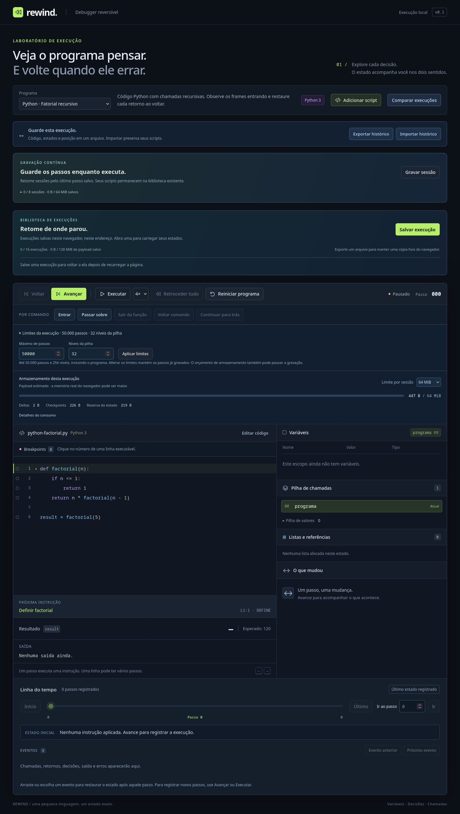

# Limites configuráveis e formatos compatíveis

O debugger mantém **20.000 passos / 256 níveis de pilha** como padrão. O painel **Limites da execução**, próximo ao orçamento de armazenamento, permite escolher **1 a 50.000 passos** e **2 a 256 níveis**, incluindo o frame do programa. As preferências são salvas por script/exemplo; reiniciar conserva a escolha e recarregar a recupera.



## Alterar uma execução

1. Pause, abra **Limites da execução** e informe os valores.
2. Clique em **Aplicar limites**. A aplicação preserva cursor, estado e todos os deltas.
3. Se a gravação parou pelo número de passos, aumente o limite e execute novamente para continuar a partir da mesma fronteira.

O número de passos não pode ficar abaixo da quantidade **já gravada**, mesmo quando o cursor voltou ao início. O limite da pilha também considera a maior profundidade de todo o histórico, incluindo o futuro registrado. Uma redução incompatível é recusada antes de modificar qualquer limite.

Limite de passos é uma pausa de gravação, não um erro da VM. Os controles encerram o plano e permitem navegar nos dois sentidos; a API de baixo nível `forward()` continua lançando `HistoryLimitError` ao tentar ultrapassar a fronteira. Aumentar o limite não desfaz uma falha que já foi registrada, inclusive erro por profundidade de chamadas: para executar aquele código com outra política, reinicie o programa.

Históricos importados/materializados usam os limites que pertencem à gravação e os mostram como somente leitura. **Executar código de novo** mantém esses valores numa sessão gravável, onde podem ser alterados. A criação de uma **gravação contínua** copia os limites da execução atual; retomar uma sessão usa sua fonte persistida, sem trocar limites conforme a preferência local de outra execução. Os limites da sessão contínua são fixados na criação: mudar a fonte assinada durante a gravação quebraria a cadeia de hashes.

Configurações ficam em `rewind.execution-limits.v1`, separadas dos scripts e bibliotecas. Uma preferência ilegível é ignorada na leitura e preservada no armazenamento. Falta de espaço não desfaz a aplicação local dos limites; a interface informa que a preferência não pôde ser salva.

## Compatibilidade explícita

O formato escolhido depende do **limite declarado**, mesmo se a gravação ainda tiver poucos passos:

| Armazenamento | Limite até 20.000 | Limite acima de 20.000, até 50.000 |
| --- | --- | --- |
| Arquivo `rewind-trace` | Envelope v2 | Envelope v3 |
| Captura `rewind-blocks` | Manifesto v1 | Manifesto v2 |
| Journal `rewind-live` | Fonte v1 | Fonte v2 |
| Semântica/codec | `rewind-vm/2` | `rewind-vm/2` |

O leitor novo aceita as duas variantes de cada formato. A escrita dentro dos limites antigos continua produzindo as versões antigas. Manifestos/fontes legados não passam a aceitar 50.000 simplesmente porque seu checksum foi recalculado: a versão também seleciona o teto aceito. Formatos futuros, checksums inválidos, limites não inteiros ou além dos tetos são recusados.

Os bancos IndexedDB continuam com schema v1: fonte, blocos, catálogo e hashes têm a mesma estrutura. O novo catálogo aceita registros antigos e ampliados juntos. Não há migração destrutiva, apagamento ou reescrita dos históricos existentes. Os leitores antigos não suportam as gravações ampliadas e podem recusar catálogos que contenham contagens acima de 20.000; use a versão atual para abrir esses dados. A compatibilidade garantida é a versão atual ler os dados anteriores, além de continuar escrevendo formatos antigos quando aplicável.

`execution-limits.ts` concentra padrão/tetos e validação da configuração. Sessões, builders, cabeçalhos de Workers e materialização preservam passos e pilha. Catálogos/checkpoints/prefixos aceitam cursores até o teto ampliado; IDs de frames seguem o teto de passos, independentemente da profundidade simultânea. Reservas, VM, instruções, deltas e a quantidade máxima de checkpoints não mudam.

Exportação e captura copiam fonte/limites/cursor/registros antes do primeiro `await`. Uma alteração de configuração ou reinício durante a operação não muda o cabeçalho da cópia em preparação.

## Quotas e escala

50.000 é um teto de instruções, não uma promessa de que qualquer programa cabe. Permanecem os orçamentos de payload, 32 MiB por arquivo/execução persistida, 4 MiB para eventos do journal, quotas de bibliotecas e o orçamento agregado da página. Uma execução pode pausar antes pelo espaço e continuar com seu prefixo acessível. A reserva para leitura mantém os blocos grandes navegáveis depois de uma pausa por bytes.

Heap, itens de listas, operandos, saída e tamanho de `print` têm limites próprios: não foram multiplicados junto com os passos. Não há retenção parcial ou descarte do início/futuro. Uma transação individual, cópia, serialização ou renderização ainda pode levar mais que a meta de tempo de um lote.

## Validação e reprodução

```bash
npm run check
npm run build
npm run test:firefox
npm run test:firefox -- --limits-only
npm run bench:stress
REWIND_STRESS_STEPS=50000 npm run bench:stress
```

`execution-limits.test.ts` cobre configurações inválidas, aumento preservando a execução, redução contra o histórico futuro, importação/forks/reinício, preferências ilegíveis, snapshots assíncronos e 50.000 passos. Journal legado/ampliado e capturas legadas/ampliadas coexistem na mesma biblioteca; arquivo v3 e captura v2 são comparados com a execução sequencial, incluindo cursores 19.999, 20.000, 20.001, 32.769, 49.999 e 50.000. Spies verificam replay/retomada sem executor. Testes existentes continuam cobrindo versões futuras, quotas, corrupção, atomicidade, cancelamento e reversibilidade de heap/erros/chamadas.

O ensaio `--limits-only` usa Firefox instalado, perfil isolado, IndexedDB e Workers da aplicação. Verifica aumento sem perder o passo 17, conclusão do fatorial, reinício/recarga, cópia dos limites para gravação contínua, materialização e layout de 390 px. Depois grava 50.000 passos de um contador em loop, navega nos dois sentidos, retoma com/sem validação integral, captura, exporta/reimporta e reabre pela biblioteca paginada. A referência independente é criada depois dessas fases.

Operações longas são acompanhadas por consultas curtas ao harness; um timeout de 20 segundos do protocolo não é tratado como falha da VM. O ensaio usa cache de 16 KiB para exercitar leituras sob pressão, e algumas transferências integrais levam dezenas de segundos. A página responder ao polling comprova que o protocolo pode continuar trabalhando; não equivale a medir pintura, latência de input ou RAM. Os [dados do Firefox](execution-limits-browser.json) registram tempos, bytes, validações e estados exatos. São diagnósticos de uma máquina/ambiente, não SLA.

Na coleta de 28/10/2026 com Firefox 150.0, a execução de 50.000 passos gerou um arquivo de **21.539.491 bytes**, comparou **3.130 estados completos**, reutilizou os 50.000 passos sem reconferir blocos na retomada rápida e reconferiu todos na opção integral. Gravação levou cerca de 9 s; captura integral com cache de 16 KiB, 17 s; exportação/importação e salvamento, 9 s. Esses tempos incluem RPC e I/O, não isolam CPU nem representam limites de latência.

A [matriz de estresse com limite declarado de 50.000](extended-stress-browser.json) repete os três programas grandes, cinco pares de retomadas por programa e falhas nativas de quota, pré-flush, corrupção, resposta perdida e auxiliares. Oito testes correspondentes também rodam com essa configuração. O comando sem variável mantém a configuração legada de 20.000, permitindo verificar as duas variantes.

Nenhuma dependência global foi instalada/atualizada. Chromium/WebKit continuam pendentes de ambiente com os browsers de teste disponíveis.
