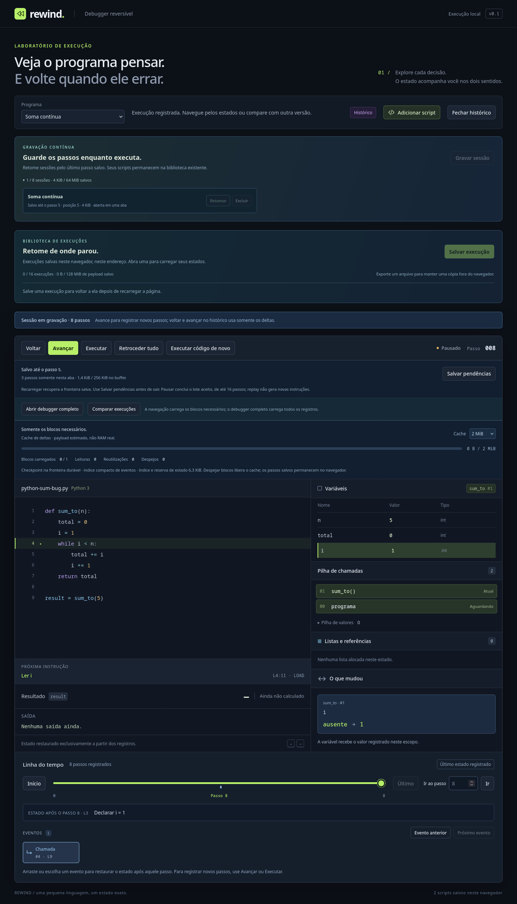
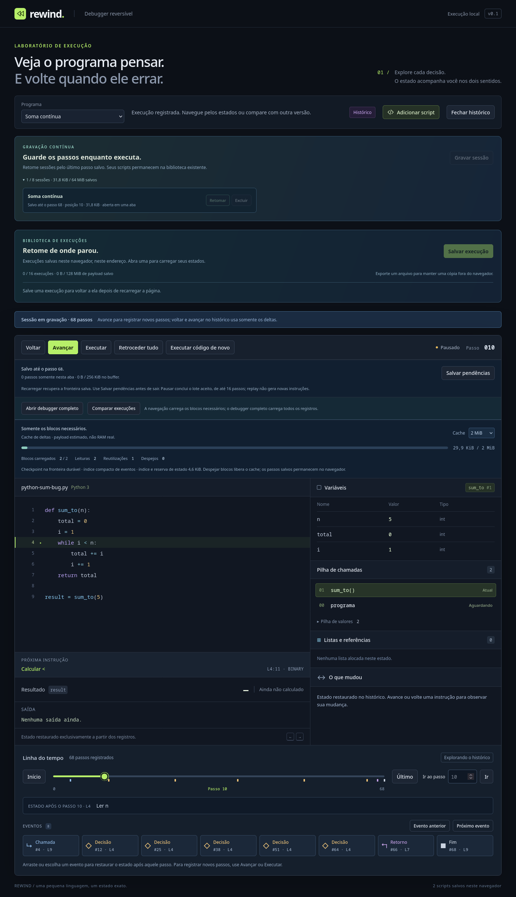

# Gravação persistida durante a execução

Atualização: [limites configuráveis e versões ampliadas](execution-limits.md) permitem até 50.000 passos: envelope v3 / manifesto v2 / fonte de journal v2 quando o limite excede 20.000. A versão atual mantém leitura e escrita legadas dentro dos tetos anteriores, com a mesma VM2 e quotas. As medidas históricas abaixo conservam as condições em que foram coletadas.

**Gravar sessão** inicia uma execução do código atual, a partir do passo zero. O modal pede um nome; a nova sessão aparece numa biblioteca própria, separada dos scripts e das capturas feitas com **Salvar execução**. É possível gravar os dois runtimes já suportados, sem efeitos externos.

Avançar além do fim registrado executa uma instrução nova. Voltar, saltar e reaplicar passos existentes usam os deltas, sem chamar o executor. A VM na fronteira gravada e a VM do cursor observado são independentes; navegar para trás preserva o futuro.

## O que está salvo

A tela mostra **Salvo até o passo N** e quantos passos estão **somente nesta aba**. **Salvar pendências** publica o buffer e a posição atual. Conclusão, erro da VM e limite de passos também disparam a escrita. Fechar a sessão ou trocar de programa pela interface primeiro tenta salvar; se falhar, mantém a sessão aberta.

**Recarregar à força, fechar a aba ou interromper o processo pode perder os passos pendentes.** Retomar recupera o prefixo durável e a posição publicada na última escrita. Não há promessa de flush assíncrono durante o fechamento do navegador. Scripts continuam preservados pelo armazenamento já existente.

## Buffer e cache

| Parte | Contrato |
| --- | --- |
| Buffer de novos deltas | Até 128 instruções ou 256 KiB de JSON UTF-8. Escreve antes de adicionar um passo que excederia o buffer. |
| Transação indivisível grande | Um único delta pode exceder 256 KiB; é escrito isoladamente. Nunca se corta uma mudança de estado. |
| Cache de replay | LRU de 2 MiB por padrão, ajustável até 8 MiB. Bloco maior que o cache é lido isoladamente. |
| Índice de eventos | Incremental e compacto, até 4 MiB, sem snapshots por evento. |
| Estado | Fronteira e cursor observado, com staging privado para saltos. Último checkpoint durável substituído por bloco, não por instrução. |
| Limites de execução | 20.000 passos por padrão, até 50.000 configurados na criação, e até 256 frames. Nenhuma retenção parcial nem descarte automático do início/futuro. |
| Disco | Até oito sessões / 64 MiB no journal; cada sessão até 32 MiB de payload. |

O orçamento lógico admite uma instrução antes da confirmação, contando buffer, índices, cache e reserva de cinco vezes o maior estado e duas vezes o maior delta. A UI reserva novamente o orçamento do ator/espelho no teto agregado de 256 MiB da página. Essas estimativas não medem RAM nem a ocupação física do IndexedDB: fonte, compilador, overhead de objetos/React/DOM e cópias transitórias do codec têm custos adicionais.

## Journal e fronteira atômica

`rewind.recording-journal` **v1** contém catálogo leve, fontes imutáveis, cabeças e blocos. Cada fonte fixa runtime, programa, estado inicial e limites. A cabeça registra revisão monotônica, fronteira, cursor, descritores e checkpoint na fronteira. Fonte, checkpoint e conteúdo dos blocos têm checksums SHA-256; os descritores formam uma cadeia de selos desde a identidade da fonte.

Uma transação curta publica **bloco + cabeça + catálogo**. Hashes/serialização são preparados fora dessa transação. Falta de espaço, cancelamento antes do commit ou conflito de revisão deixam a cabeça anterior intacta. Resposta perdida depois de uma escrita confirmada é reconciliada pela revisão/checksum; retry não duplica registros nem saída.

Uma lease de escritor de cinco segundos, renovada a cada 1,5 segundo, impede duas abas de avançarem a mesma sessão. A aquisição compara a revisão validada. Depois de um reload abrupto, a lease anterior pode levar até cinco segundos para expirar. O fechamento normal libera o escritor. Exclusão exige sessão fechada ou lease expirada e remove somente os registros daquele ID.

Retomar verifica fonte/programa/runtime e encadeamento, reutiliza um prefixo previamente validado quando disponível e confere o sufixo lendo um bloco por vez. Compara o estado final com o checkpoint durável antes de assumir o escritor e restaurar o cursor. Sem cache, ou com **Verificar todo o histórico ao retomar**, percorre todos os passos sem reter o histórico inteiro decodificado. [Contrato da validação reutilizável, falhas e medidas](segment-validation.md).

Os bancos anteriores de scripts, capturas e checkpoints auxiliares permanecem compatíveis. Arquivos exportados usam **v2/v3 conforme o limite declarado, com rewind-vm/2**. Um banco de versão futura é recusado, sem apagar dados.

## Falhas, confirmação e resgate

Erros de escrita pausam a gravação fora do estado da VM. Todos os passos aceitos, inclusive o futuro volátil, permanecem navegáveis na aba. **Salvar pendências** tenta novamente. Falta de espaço não é convertida num erro inventado do programa.

O Worker usa **preparação → ACK da UI → commit/escrita → estado publicado**. Cancelar antes do ACK desfaz a instrução especulativa ou abandona o salto privado. Depois do ACK, o pedido foi aceito e termina antes do próximo pedido. **Pausar** conclui o lote aceito de até 16 passos; não desfaz passos já aceitos. A fila conserva apenas um pedido ativo e o destino pendente mais recente.

**Abrir debugger completo** e **Comparar execuções** transferem registros em lotes de até 16 para um builder privado, incluindo o futuro que ainda está no buffer. A captura sequencial mantém o bloco em uso entre lotes e aguarda a confirmação de consumo, evitando releituras quando ele não cabe no LRU. [Contrato e medidas](transfers-and-output.md). Só publicam a sessão integral ao concluir. Esse caminho permite exportar mesmo se o journal estiver sem espaço; passa a usar o histórico integral em memória e encerra a gravação contínua. O journal preserva sua última fronteira durável, e a lease expira após a transferência. Exportar/salvar a captura integral é uma ação explícita.

## Validação

`tests/live-recording.test.ts` compara todos os estados nas duas direções com uma execução sequencial, incluindo recursão, erros, BigInt, números especiais, listas compartilhadas/cíclicas e nomes especiais. Também cobre navegação gerada, rollback antes da confirmação, orçamentos, lease concorrente, interrupção, corrupção, quota, retry e captura do futuro volátil.

`scripts/live-browser-flows.mjs`, integrado a `npm run test:firefox`, usa o Firefox instalado e um perfil do projeto. Verifica reload com passos pendentes, retomada exata, replay, fechamento, materialização/comparação, exclusão e largura de 390 px. O cliente RPC de produção compara estados completos com referência sequencial e cancela precisamente antes/depois do ACK. A injeção de `QuotaExceededError` ocorre num Worker/banco de teste e verifica rollback do IndexedDB nativo, preservação do buffer e retry sem duplicação; não enche o disco da máquina.

No Firefox 150.0, a referência sequencial conferiu os estados de uma execução de 777 instruções com alias, mutações de lista e saída. Esse cenário usa buffer de 4 KiB e cache de 2 KiB para forçar fronteiras frequentes; já havia 28 blocos publicados enquanto a execução ainda estava no passo 241. O fluxo de UI usa os padrões e verifica cinco passos salvos/três voláteis antes de um reload controlado.

O relatório reproduzível fica em `.artifacts/live-recording-browser.json`; uma cópia desta entrega está em [live-recording-browser.json](live-recording-browser.json). O teste não baixa navegador nem instala ou atualiza componentes globais.

A reserva de payload inclui também a leitura do maior bloco durável ou do buffer que formará um bloco. Isso mantém a navegação disponível após uma pausa por bytes; o limite pode ser atingido mais cedo, preservando o prefixo aceito.

## Controles no modo paginado/contínuo

Os mesmos breakpoints e passos por comando estão disponíveis diretamente em **Abrir**, **Gravar sessão** e **Retomar**, com política compartilhada, lotes de até 16 e fronteira parcial explícita. [Contrato, demo e testes](paged-controls.md). A explicação paginada corresponde à última instrução do lote; o debugger completo oferece a agregação por comando.
