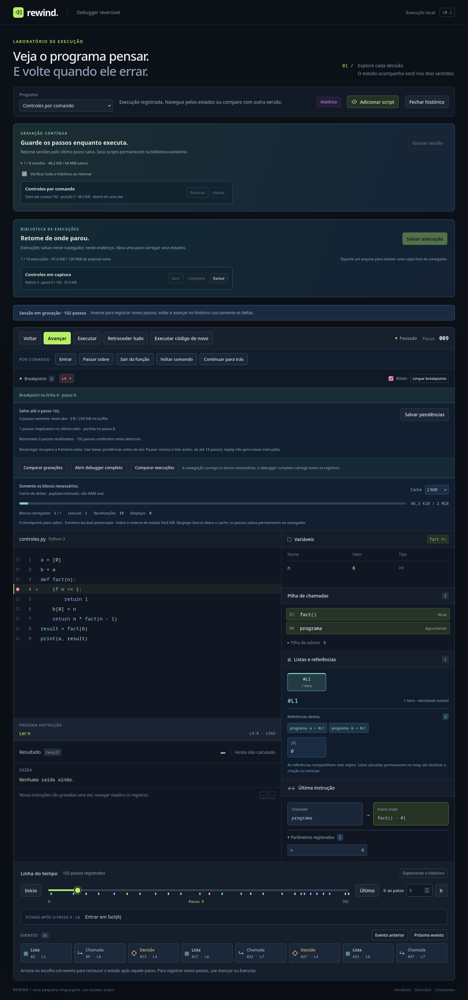

# Controles de depuração em sessões contínuas e capturas paginadas

**Gravar sessão**, **Retomar** e **Abrir** agora oferecem breakpoints, **Entrar**, **Passar sobre**, **Sair da função**, **Voltar comando** e **Continuar para trás**. Não é necessário abrir o debugger completo para usar esses controles. A política de parada é compartilhada com o modo clássico; a VM e os deltas mantêm a mesma semântica.



## Experimentar

1. Escolha **Python · Soma com bug**, clique em **Gravar sessão**, dê um nome e inicie a gravação.
2. Marque a linha **4** (`while i < n`) e clique em **Executar**. A pausa ocorre antes de avaliar a condição, com `i = 1` e `total = 0`.
3. Execute novamente. A próxima ocorrência tem `i = 2` e `total = 1`. **Continuar para trás** restaura a ocorrência anterior com todos os campos originais.
4. Remova o ponto ou desative **Ativos**. **Sair da função** percorre os comandos até o retorno, preservando o valor na pilha de operandos antes da atribuição no chamador. **Passar sobre** conclui essa atribuição.
5. Use **Salvar pendências** e feche. **Retomar** recupera a posição salva; os breakpoints são configuração da abertura atual e precisam ser marcados novamente.

Em uma captura da biblioteca, **Abrir** dá os mesmos controles nos passos existentes. O fim de uma captura parcial é uma parada explícita; continuar não executa o trecho que faltou gravar. **Executar código de novo** materializa e reinicia a execução, como antes, preservando os pontos da abertura atual. **Abrir debugger completo** também transfere a configuração.

As [regras de comandos e breakpoints](breakpoints-stepping.md) valem nos três modos: pausa antes da entrada do comando, retomada ignora apenas a ocorrência atual, breakpoints internos interrompem Passar sobre/Sair, e IDs de frames distinguem recursão. Voltar comando segue a ordem cronológica dos registros; não desfaz uma ação inteira de Passar sobre como uma unidade.

## Política única e armazenamento

`ExecutionPolicy` é um gerador: pede uma transação para frente ou para trás e decide onde parar depois de recebê-la. O driver síncrono `ExecutionControl` chama `DebugSession.forward/backward`. O driver assíncrono `PagedExecutionControl` chama `LiveRecording.seek` ou `PagedHistoryStore.seek` por uma instrução. Ambos consomem a mesma política, sem duplicar condições de entrada, retorno ou retomada.

O plano mantém modo, cursor inicial, ID do frame original e a regra de ignorar o ponto inicial entre lotes. O Worker devolve apenas o estado atual, a última explicação e metadados de controle; não transfere `Step[]` integral nem guarda snapshots por comando. Os caches, checkpoints esparsos e quotas anteriores continuam em uso. Não há mudança de banco nem do formato v2/VM2.

O journal reserva também o payload de leitura do maior bloco durável (ou do buffer que formará um bloco). Essa reserva permite continuar navegando depois de atingir o orçamento da gravação, sem depender de esvaziar o buffer ou aumentar o limite. A admissão pode pausar mais cedo; os passos já aceitos continuam disponíveis. Os números mostrados são estimativas de payload, não medidas de RAM real.

## Aceitação, pausa e falhas

Os dois Workers usam fila serializada com um pedido ativo e o pedido pendente mais recente:

- **Salto manual:** calcula destino em estado privado → envia `prepared` → recebe ACK → publica o destino → envia `state`. Cancelar antes do ACK conserva cursor, estado e autorização de retomar um breakpoint.
- **Ação por comando:** valida o pedido → envia `prepared` → recebe ACK → percorre até 16 transações ou uma parada → envia `state`. A UI pede o lote seguinte sem reiniciar o plano, devolvendo o controle ao navegador entre lotes.
- **Pausar:** cancela o que ainda não foi aceito e encerra o plano depois do lote aceito. Cancelar depois do ACK não desfaz transações aceitas. Navegar substitui o plano; entre destinos pendentes somente o mais recente permanece na fila.

`prepared` transporta somente ID/tipo. O estado privado permanece no Worker até o ACK; somente `state` leva o snapshot publicado. O [perfil de recursos](resource-profile.md) identificou e removeu a cópia anterior que o cliente não consumia, preservando o protocolo de aceitação.

Falhas de leitura/escrita encerram o plano e mostram o último estado válido; não criam um erro fictício no programa. Falhas de escrita mantêm buffer e futuro para retry. Um erro da própria VM, por sua vez, continua sendo uma transação reversível. Limite de bytes/passos é identificado como pausa por orçamento. Comandos inválidos são recusados antes de aceitar o lote.

**Última instrução** explica a transação final do lote, inclusive ao voltar. Esse painel não representa todas as mudanças do comando; intervalos e atribuições agregadas continuam disponíveis no debugger completo. Não há persistência de breakpoints entre aberturas, breakpoints condicionais ou aumento dos limites de execução neste marco.

## Verificação reproduzível

```bash
npm run check
npm run build
npm run test:firefox -- --controls-only
npm run test:firefox
```

`tests/paged-execution-control.test.ts` compara resultados, paradas e estados completos com o controlador clássico em lotes de 1/3/16, incluindo sequências geradas nos dois runtimes, chamadas aninhadas, recursão, retorno implícito, aliases/ciclos, saída e erro. Verifica que replay não chama o executor, não duplica registros e respeita cache/fronteira parcial. Testa limite de passos, admissão por bytes com navegação posterior e payload estimado dentro da quota, falha de flush/retry e leitura corrompida com recuperação.

`scripts/paged-controls-browser-flows.mjs` executa os Workers de produção e o IndexedDB real no Firefox instalado, com perfil isolado no projeto. Compara cada lote com a referência clássica, testa cancelamento precisamente antes/depois do ACK, o último destino pendente, captura parcial, comandos em UI contínua/captura, transferência de breakpoints no reinício, limite de 64 KiB com desfazer/replay completos e largura de 390 px. Não instala componentes globais nem baixa navegadores. Chromium/WebKit continuam como validação pendente de ambiente com esses engines disponíveis.

O relatório [paged-controls-browser.json](paged-controls-browser.json) registra amostras de latência de RPC por lote e cache, em cenário de 102 instruções. O cache de 1 KiB força leitura isolada dos blocos maiores; por isso o máximo retido pode ser zero, sem significar ausência de leituras. Tempos incluem comunicação, I/O, validação e codec e não constituem uma garantia de desempenho. Medição de picos reais de memória e workloads maiores permanece como a próxima etapa antes de ampliar sessões.
