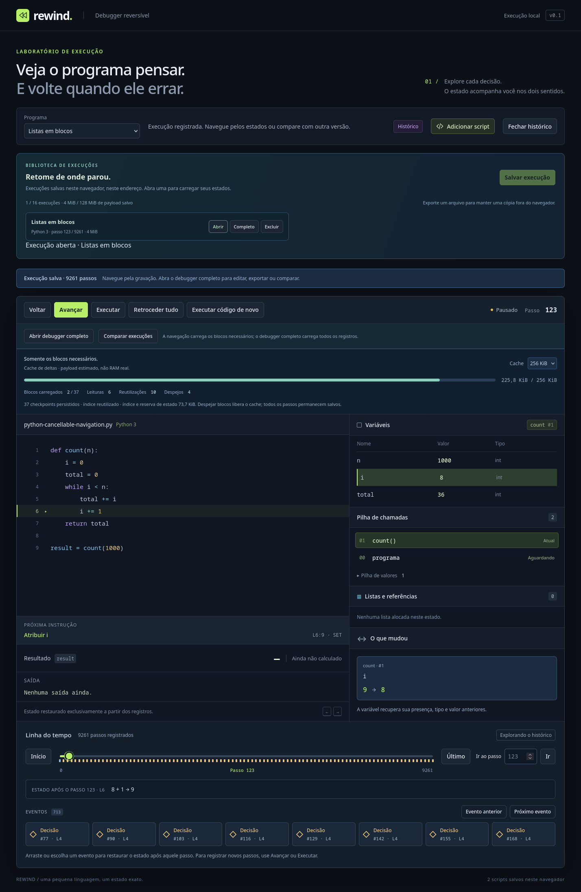

# Histórico carregado sob demanda

**Abrir** uma execução salva agora inicia uma navegação com cache de deltas. A VM permanece no Worker; a interface recebe somente o estado publicado, o índice leve de eventos e a explicação da última mudança. A gravação original continua integral em IndexedDB.



## Experimentar

1. Execute **Python · Navegação longa** com orçamento de **4 MiB**: ela pausa com 9.261 passos.
2. Vá ao passo `123`, salve a execução e recarregue.
3. Clique em **Abrir**. Na primeira abertura, o Worker valida a cadeia e prepara checkpoints auxiliares. Nas seguintes, reutiliza o índice e lê somente os blocos necessários ao cursor.
4. Em **Cache**, escolha **256 KiB**. Salte para `4000`, `8100`, `2000`, `6000` e `123`. Observe leituras, reutilizações e despejos: os blocos carregados permanecem dentro do orçamento, enquanto todos os passos continuam na linha do tempo.
5. Avance/volte uma instrução para observar as mudanças, variáveis, pilha, heap e saída restaurados. Os eventos continuam navegáveis sem carregar todos os deltas.
6. **Cancelar navegação** mantém a posição e o estado anteriores ao pedido. Um destino novo substitui o pedido antigo. Trocar programa ou fechar a execução encerra seu Worker.
7. **Abrir debugger completo**, **Comparar execuções** ou o botão **Completo** da biblioteca carregam todos os registros para edição, exportação, explicações agregadas e comparação integral. O orçamento agregado continua sendo verificado; falha/cancelamento mantém a visualização anterior.

O limite do cache volta a **2 MiB** a cada abertura, ajustável na interface de 64 KiB a 8 MiB conforme o orçamento disponível. Limites internos menores também são usados nos testes. As capturas não mudam ao navegar. Para guardar outra posição, abra o debugger completo e use **Salvar execução** novamente.

## Armazenamento e contratos

`PagedHistoryStore` tem uma API assíncrona de `open`, `seek`, `setCacheBudget`, `cancel` e `dispose`. Não expõe um `Step[]` completo. O índice contém eventos compactos, descritores de checkpoints e os maiores payloads observados de estado/transação; a linha do tempo usa esses metadados diretamente.

O cache de blocos usa LRU: uma leitura/reutilização torna o bloco recente; entradas antigas são removidas antes de admitir outro bloco. O limite mede JSON UTF-8 dos blocos, **não RAM real**. Uma transação indivisível maior que o cache ocupa um bloco isolado: ela é lida, aplicada e liberada sem ser retida. Seu payload precisa caber no orçamento total; nada é dividido ou truncado. O último delta e as VMs de trabalho têm reservas próprias fora do limite do cache.

O banco original **`rewind.execution-library` v1**, o manifesto **`rewind-blocks` v1** e os arquivos `.rewind.json` **v2** permanecem compatíveis. Capturas antigas ganham o índice auxiliar ao abrir pela primeira vez; nenhuma migração ou substituição de seus deltas é necessária. **Completo** continua usando a restauração integral anterior, inclusive quando o cache auxiliar não pode ser criado.

## Checkpoints persistidos e primeira validação

O banco auxiliar **`rewind.checkpoint-cache` v1** tem três stores: catálogo leve, índices e checkpoints por `[token,cursor]`. A chave lógica junta o ID da execução e o checksum do manifesto original, impedindo reutilizar o índice de outra gravação. Cada indexação tem token próprio; abas concorrentes não publicam sobre checkpoints incompletos de outra indexação.

A primeira abertura percorre a cadeia completa **um bloco por vez**, validando cada delta contra a VM privada, sem guardar os blocos anteriores. A contabilização do estado é incremental; não se copia toda a memória a cada instrução. Até 128 checkpoints são produzidos nas fronteiras de blocos e no fim, respeitando a quota auxiliar. Estado inicial permanece implícito e sempre disponível. Eventos mantêm origem/cursor/tipo; suas descrições são abreviadas em até 240 caracteres somente no índice.

O índice só aparece como `ready` depois da validação completa. Cancelamento/falha limpa a reserva incompleta daquele pedido quando o Worker pode concluir o cleanup. Se a aba/processo morrer, o prazo de cinco minutos permite recolher reservas antigas na próxima indexação. Checksum SHA-256 cobre índice e checkpoints, além dos hashes já presentes nos blocos originais. Checkpoints decodificados também passam por validação de frames, valores, referências, contadores e reserva do estado. Isso protege integridade de dados locais; não constitui assinatura/autenticação de autoria.

## Busca e publicação atômica

O store escolhe entre copiar o estado publicado e restaurar o checkpoint mais próximo, aplicando deltas nos dois sentidos. A cópia acontece por pedido/checkpoint, não por passo. Leitura de bloco verifica identidade, tamanho e checksum. Avanço valida a transação contra o estado anterior; retrocesso verifica os valores/splices posteriores e valida a cadeia novamente, sem executor nem operações matemáticas inversas.

O destino é preparado em VM privada. Durante I/O e replay, a tela conserva seu cursor/estado. Progresso se refere ao trabalho privado; os dois só são publicados depois do destino completo e da confirmação da UI. Se o cliente cancelar/descartar a resposta preparada, não envia ACK e a VM do Worker também conserva o cursor anterior. Se aceitar, o ACK precede qualquer próximo pedido e o destino aceito é concluído. Antes do ACK, cancelar ou substituir invalida o epoch; o cliente descarta respostas antigas. A fila mantém somente o pedido pendente mais recente. Transações são processadas em lotes de até 16 ou alvo de 6 ms, com yields entre lotes. Isso mantém cancelamento e paint possíveis, sem garantia de tempo real: compilação, cópia, codec, uma transação grande e renderização podem ser indivisíveis.

Um checkpoint ausente por despejo do cache auxiliar permite reconstruir o destino a partir do estado inicial, mantendo progresso/cancelamento. Checkpoint ou bloco corrompido causa recusa explícita, conservando a VM publicada. Não se ignora corrupção como se fosse ausência de dados.

## Quotas e retenção

| Camada | Limite e política |
| --- | --- |
| Gravação original | 32 MiB por captura; biblioteca 16 execuções/128 MiB. Nenhum despejo automático de gravações. |
| Cache auxiliar em disco | 64 MiB e 16 indexações, incluindo reservas em andamento. Despeja índices prontos menos recentes; não despeja uma indexação ativa para admitir outra. |
| Checkpoints por indexação | 8 MiB; cópias adicionais são omitidas se não couberem. |
| Índice por indexação | 8 MiB; eventos têm reserva conservadora de até 4 MiB. |
| Deltas carregados no Worker | 2 MiB por padrão, até 8 MiB, com LRU. Um bloco grande pode ser processado sem retenção. |
| Payload total do viewer | Cache + índice + reserva de duas VMs + maior transação, dentro do limite admitido ao abrir. |
| Página | Até 256 MiB de reservas lógicas: sessão anterior, históricos completos retidos, viewer/espelho da UI e staging de novas aberturas/materialização. |

O cache auxiliar pode ser recomputado; seu despejo nunca apaga scripts ou execuções originais. Fonte/programa, índices do motor, buffers JSON transitórios, overhead de objetos e React/DOM não equivalem à estimativa de payload. A quota física do navegador é independente. Falta de espaço para dados auxiliares oferece abrir **Completo**, preservando a gravação original; não se solicita instalação ou persistência especial no navegador.

**Fechar histórico** termina o Worker e libera a reserva do viewer. **Excluir** a execução atualmente explorada fecha esse viewer, conforme o modal, pois as leituras futuras dependem do disco. Históricos que já foram carregados por inteiro ficam independentes e continuam preservados. Exclusão em outra aba pode fazer uma leitura futura falhar; o último estado publicado permanece disponível. A aba original do debugger e os scripts não são substituídos ao explorar uma captura.

Não há retenção parcial, compressão nem aumento do teto de **20.000 passos**. O caminho de execução comum, importação de arquivo e comparação usa o store integral. O marco seguinte adicionou **Gravar sessão**, com um journal separado, buffer limitado e paginação de execuções graváveis; consulte [gravação contínua](live-recording.md). Validação reutilizável de segmentos e medidas de picos temporários continuam necessárias antes de ampliar sessões.

## Validação e diagnóstico

```bash
npm run check
npm run build
npm run test:firefox
```

Testes verificam todos os campos em cada cursor nos dois sentidos, chamadas/recursão, listas/aliases/ciclos, erro, saída, números especiais, vazio e parcial. Navegação gerada cruza blocos/checkpoints/despejos. Leitura atrasada, cancelamento inclusive na confirmação final, supersessão, corrupção, quotas concorrentes, reservas expiradas, versões futuras e transação maior que o cache preservam os dados originais. Spies comprovam ausência de executor durante replay.

O Firefox **150.0 instalado**, com perfil isolado e sem downloads, verificou a UI, IndexedDB e cliente RPC de produção. Uma referência sequencial independente comparou estados completos, inclusive campos que a interface pagina/esconde. Reabertura da gravação de **9.261 passos / 37 blocos** leu **um bloco**, reutilizando o índice. O cache de **256 KiB** manteve até três blocos — o último é pequeno — durante dez destinos, com sete leituras e quatro despejos. [Registro gerado pelo teste](paged-history-browser.json).

O teste observa heartbeat/paint antes de cancelar, mantém o cursor 0, substitui o destino por 123, restaura após remover checkpoints derivados e recusa um bloco corrompido sem publicar estado parcial. Também cobre materialização/compare, fechamento, troca de programa, exclusão confirmada, scripts preservados e 390 px. Tempos no JSON são diagnósticos locais de Worker/I/O/codec/timers; não medem RAM nem garantem latência em outro hardware.

## Controles no modo paginado/contínuo

Os mesmos breakpoints e passos por comando estão disponíveis diretamente em **Abrir**, **Gravar sessão** e **Retomar**, com política compartilhada, lotes de até 16 e fronteira parcial explícita. [Contrato, demo e testes](paged-controls.md). A explicação paginada corresponde à última instrução do lote; o debugger completo oferece a agregação por comando.
