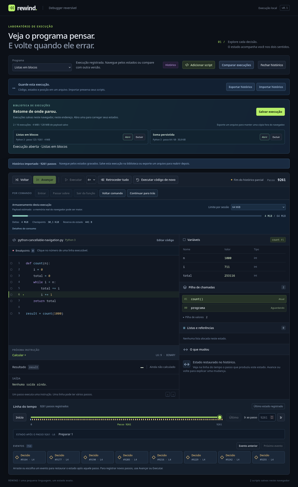

# Execuções salvas em blocos

Atualização de tipos: [strings Python e perfil VM3](python-strings.md) acrescentam valores de texto, mantendo leitura/escrita VM2 por perfil e as versões de envelopes/bancos. As medidas e contratos históricos abaixo identificam o estágio em que foram registrados.

Atualização: [limites configuráveis e versões ampliadas](execution-limits.md) permitem até 50.000 passos: envelope v3 / manifesto v2 / fonte de journal v2 quando o limite excede 20.000. A versão atual mantém leitura e escrita legadas dentro dos tetos anteriores, com a mesma VM2 e quotas. As medidas históricas abaixo conservam as condições em que foram coletadas.

**Salvar execução** guarda fonte, runtime, deltas e cursor no IndexedDB do navegador. A biblioteca mostra seis entradas por página; execuções fechadas mantêm somente metadados na interface. **Abrir** valida os blocos e restaura o cursor salvo, incluindo o futuro já registrado. Os passos continuam sendo transações reversíveis, sem snapshots de toda a memória a cada instrução.



## Experimentar

1. Execute **Python · Soma com bug**, obtendo `10`.
2. Vá ao passo `64`, dentro de `sum_to`.
3. Clique em **Salvar execução**, escolha um nome e confirme **Salvar**.
4. Reinicie o programa ou recarregue a página. Os scripts permanecem na biblioteca existente; a execução salva aparece na nova biblioteca.
5. Clique em **Abrir**: o frame de `sum_to`, seus locais, operandos e próxima instrução reaparecem no passo `64`.
6. Vá ao início e ao último passo. O resultado continua `10`, sem executar código novamente. Compare a gravação com a soma corrigida para observar `10` / `15`.
7. **Fechar histórico** libera a entrada carregada nesta página. **Excluir** na biblioteca remove a execução do navegador, com confirmação, preservando scripts, arquivos exportados e históricos carregados por inteiro. Se essa execução estiver no viewer paginado, o modal informa que ele será fechado, pois as leituras dependem do disco.

Salvar cria uma captura imutável com novo ID. Navegar, gravar passos novos ou reiniciar depois não altera essa captura; salve novamente para guardar outra posição. Recarregar restaura a lista de execuções, sem carregar todas as VMs nem substituir o rascunho selecionado. Abrir uma entrada já carregada reutiliza seu histórico e restaura o cursor da captura original.

## Formato e integridade

Banco **`rewind.execution-library`**, versão **1**, separado de `rewind.script-library.v1`:

| Store | Conteúdo |
| --- | --- |
| `catalog` | Nome, runtime, cursor, quantidade de passos/blocos, bytes, status e prazo de gravação. Sem fonte ou deltas. |
| `manifests` | Fonte, identidade SHA-256 do programa compilado, VM, limites, estado inicial, cursor e descritores dos blocos. Checksum do manifesto. |
| `blocks` | Chave `[runId, index]`, início/contagem/tamanho/checksum e JSON de deltas. Índice `runId` para exclusão. |

Formato de blocos **`rewind-blocks` v1**, compatível com **`rewind-vm/2`** e com as tags do codec portável v2. Uma versão futura é recusada explicitamente; o banco não é apagado ou recriado. Arquivos `.rewind.json` v2 continuam importáveis/exportáveis; salvar no navegador usa seu próprio manifesto e não muda o envelope desses arquivos.

Blocos contêm até **256 passos** ou **512 KiB**. Uma transação maior ocupa um bloco sozinha, limitada pelo teto de 32 MiB por execução. Não se corta uma mutação ao meio. SHA-256 cobre cada bloco e o manifesto; a leitura verifica identidade, índices contíguos, quantidades, tamanhos, runtime/programa e estado inicial. A validação da cadeia de transações confere frames, valores, heap, referências e contadores antes de publicar a VM. Checksums detectam corrupção; não são assinatura ou prova de autoria.

Somente deltas e o estado inicial são persistidos. Checkpoints esparsos são reconstruídos conforme o orçamento ao abrir. `RecordingBuilder` recebe lotes diretamente numa VM privada; cadeia inválida, incompleta ou cancelada nunca substitui a sessão aberta.

## Gravação, interrupção e abas

1. Capturar fonte, metadados, cursor e referências aos deltas congelados antes do primeiro `await`.
2. Reservar uma entrada `writing` e bytes no catálogo, em transação curta.
3. Codificar/hashar fora das transações; adicionar cada bloco e sua reserva em uma transação atômica.
4. Publicar manifesto e status `ready` juntos, somente depois de todos os passos.

Cada transação verifica a quota agregada no catálogo, incluindo reservas de outras abas. Cancelamento ou erro limpa somente a gravação incompleta daquele pedido. Uma execução já publicada permanece salva.

Se a aba/processo morrer antes de concluir, seus blocos não aparecem na lista. A reserva tem prazo de **cinco minutos**, renovado por bloco. Ao abrir a biblioteca ou iniciar outra gravação, `recover()` remove somente reservas incompletas expiradas e seus blocos. Uma reserva recente de outra aba fica intacta; uma aba suspensa além desse prazo pode ter sua gravação incompleta recusada ao retomar. Execuções prontas não são removidas automaticamente. Foco da janela e `BroadcastChannel` atualizam metadados após alterações em outras abas.

## Disco e sessões carregadas

| Limite | Política |
| --- | --- |
| Execução salva | Até **32 MiB** de manifesto + JSON dos blocos. |
| Biblioteca | Até **16 execuções / 128 MiB**, incluindo reservas incompletas. |
| Históricos abertos | Até **8 entradas / 64 MiB** de payload salvo/arquivo. |
| Sessão | Até **64 MiB** por padrão; configurável até **256 MiB**, conforme reserva disponível na página. |
| Página | Até **256 MiB de reservas de payload** entre sessões carregadas e temporárias. |

A reserva da página soma os limites dos históricos retidos e da sessão ativa. Importação/abertura reserva espaço para **duas** VMs privadas; comparação reserva **quatro** para os dois lados e seus destinos temporários. Payloads compartilhados são cobrados novamente, de forma conservadora. O painel impede aumentar um limite além do espaço reservado disponível. A importação/abertura reduz seu orçamento se necessário; se a gravação não couber integralmente, recusa a operação e mantém a sessão anterior. Fechar um histórico libera sua reserva. As execuções fechadas na biblioteca consomem apenas o orçamento de disco e pequenos metadados.

Esses bytes representam payloads codificados/reservados, **não RAM medida ou ocupação física do IndexedDB**. Fonte/programa, índices, React/DOM, overhead do motor, buffers JSON/codec e mensagens temporárias ficam fora da estimativa. A quota real do navegador é independente: `QuotaExceededError` aborta a gravação, preserva execuções anteriores e oferece exportar/excluir dados na mensagem.

Usar o mesmo navegador e endereço (origem, incluindo porta) é necessário para encontrar a biblioteca. Não há backend ou sincronização de conta. Exportar mantém uma cópia fora do armazenamento local, que pode ser removido ao limpar dados do navegador. Não se solicita persistência especial nem se instala/atualiza nada fora do projeto.

## Leitura cancelável e escopo de escala

Um Worker local lê **um bloco por vez**, valida checksum/cadeia e transfere lotes de até **16 transações**, aguardando confirmação da UI. A UI valida diretamente em outro builder privado, sem acumular uma segunda lista completa de transações decodificadas. A sessão só aparece depois de todos os blocos e da restauração cancelável do cursor. Cancelar encerra o Worker; pedidos numerados e troca de sessão invalidam callbacks antigos.

O marco original separou biblioteca em disco de execuções carregadas, com restauração integral. O marco seguinte acrescentou [paginação sob demanda](paged-history.md): **Abrir** usa cache/VM no Worker e checkpoints auxiliares; **Completo** mantém a restauração integral para edição/exportação/comparação. O padrão segue em 20.000 passos; limites ampliados usam o contrato versionado acima. Compilação, hash/JSON de um bloco, uma transação individual, cópia de checkpoint e renderização podem ser indivisíveis. Gravação rende entre blocos e por alvo de 6 ms durante a codificação; os tempos não são garantia de tempo real.

Não há retenção parcial automática nem descarte silencioso do início. O viewer paginado mantém cache limitado e cancelamento ao trocar blocos. Gravação paginada/validação de segmentos e medidas de picos temporários vêm antes de ampliar o teto de passos.

## Validação e medidas

```bash
npm run check
npm run build
npm run test:firefox
```

Testes com IndexedDB simulado por dependência local verificam transações, quotas/abas concorrentes, recuperação por prazo, exclusão, falhas de API, versões futuras, manifesto/bloco adulterados, leitura cancelada e builders incompletos. Referências sequenciais comparam todos os campos em cada cursor nos dois sentidos, incluindo aliases, ciclos, erros, chamadas, saída e números especiais; navegação gerada cruza blocos e spies garantem replay sem executor. A importação/exportação v2 permanece testada.

O smoke test usa o **Firefox 150.0 instalado**, perfil isolado no projeto e IndexedDB real. Salva/recarrega/reabre a soma no passo 64, compara `10`/`15`, salva uma execução maior no passo 123 e verifica futuro, cancelamento de gravação/leitura, troca de sessão, reinício, exclusão isolada, scripts preservados, 390 px e ausência de erros no console.

Na execução de 9.261 passos, foram salvos **37 blocos / 4.199.095 bytes**. Salvar levou **418,82 ms** e carregar **1.103,19 ms** nesta rodada. Os tempos incluem comandos BiDi, modal, timers/renderização, I/O, validação e restauração; não isolam CPU nem medem RAM. [Registro reproduzido pelo teste](execution-library-browser.json). Engines adicionais permanecem na matriz Playwright, sem downloads de navegadores nesta entrega.
