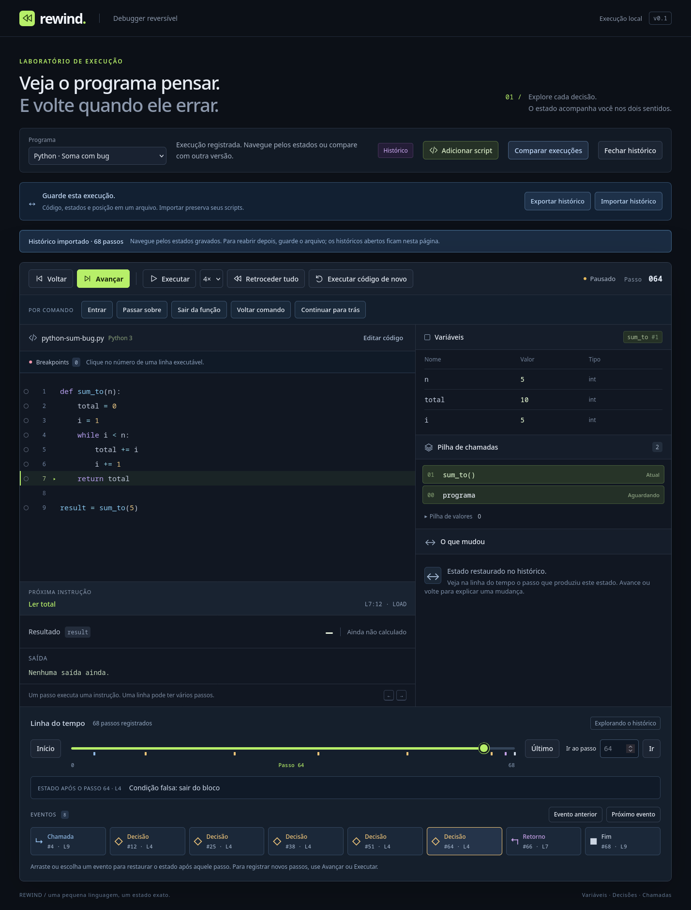

# Históricos portáveis

**Exportar histórico** baixa um arquivo `.rewind.json` com fonte, linguagem/versão, deltas, limites e cursor atual. O arquivo inclui todos os passos registrados, mesmo os posteriores ao cursor escolhido. Importá-lo reabre exatamente aquela posição, sem executar o programa novamente.



## Usar e comparar arquivos

1. Execute um programa e navegue até a posição que deseja guardar.
2. Clique em **Exportar histórico** e guarde o arquivo baixado.
3. Clique em **Importar histórico** e escolha esse arquivo. A posição, variáveis, frames, operandos, saída e controle voltam ao estado registrado. **Último** recupera também o futuro já gravado.
4. Importe uma segunda execução e abra **Comparar execuções**. O seletor B tem um grupo **Históricos importados**; as duas gravações podem ser comparadas sem gerar passos novos. Fontes comuns também continuam disponíveis e são executadas para preparar seu próprio lado da comparação.
5. **Fechar histórico** remove a entrada desta página. O arquivo no computador e seus scripts salvos permanecem. Para reabrir após recarregar, importe o arquivo novamente.

Os históricos abertos ficam somente na memória da página, separados da biblioteca de scripts em `localStorage`. Não são salvos automaticamente no navegador. **Executar código de novo** começa uma execução limpa da fonte, liberando a gravação de novos passos; a entrada importada original continua disponível até ser fechada. Editar/aplicar o código cria um script próprio sem modificar a gravação importada.

Históricos parciais param no último passo disponível, mesmo que a VM esteja `running`. A interface mostra **Fim do histórico parcial** e desabilita avançar. A comparação identifica **Fim do histórico parcial** ou **Limite da gravação**, sem apresentar isso como conclusão do programa. Breakpoints e seleção de frame da interface não fazem parte do arquivo; a pilha completa e o cursor da VM fazem.

## Formato e identidade

O envelope contém `format: "rewind-trace"`, `version: 2`, `checksum` SHA-256 e `payload`. O payload contém:

- `vm: "rewind-vm/2"`, fonte e runtime explícito;
- nome e arquivo da fonte, até 160/240 caracteres respectivamente;
- SHA-256 do programa compilado, incluindo instruções, funções, spans e metadados de depuração;
- limites de passos/frames e o estado inicial padrão;
- cursor e transações em ordem de execução.

O checksum usa a representação do payload produzida por `JSON.stringify`. Espaçamento externo pode variar, mas reordenar campos altera essa representação. O checksum detecta corrupção; não é uma assinatura do autor nem uma prova de que um produtor externo calculou corretamente toda expressão.

O codec preserva `bigint` em uma tag decimal canônica (`{"$bigint":"..."}`) e `-0`, `NaN`, `Infinity`, `-Infinity` em tags `{"$number":"..."}`. Números finitos, booleanos e `None` usam valores JSON normais; referências de funções guardam tipo e nome. Dicionários decodificados usam protótipo nulo; nomes válidos como `__proto__` e `constructor` continuam bindings próprios, sem alterar protótipos. Tags ambíguas, valores fora dos limites e campos desconhecidos são rejeitados.

Referências de lista são `{ "kind": "list", "id": 1 }`. O heap é reconstruído pelos deltas de alocação e mutação; itens contêm valores/referências, nunca cópias recursivas dos objetos. Controle inclui `nextObjectId` e `heapItems`, preservando aliases, ciclos e IDs ao retroceder.

**Compatibilidade:** v1 / `rewind-vm/1` pertence ao marco anterior, sem heap. A importação v2 recusa esses arquivos explicitamente e orienta abri-los na branch `feat/portable-histories`; arquivo, scripts e sessão atual são preservados. Não há migração automática. Um arquivo v1 real está nos fixtures de teste. Versões futuras também precisam atualizar o identificador da VM ao alterar semântica, instruções ou deltas.

## Validação e reversibilidade

A importação verifica tamanho, esquema, versão, limites, checksum, estado inicial e identidade do programa compilado. Em uma VM privada, confere cada transação: PC/opcode/span, controle anterior, cadeia de posições, índices e valores removidos pelos splices, presença/valor anterior dos bindings, escopo das escritas, estrutura de pops/pushes, literais/leituras, parâmetros e identidade dos frames, continuação das chamadas/retornos e erros atômicos. Não recalcula resultados de operações matemáticas; verifica a consistência estrutural dos valores registrados.

Somente depois de toda a validação a UI recebe uma nova sessão. Arquivo inválido, cancelamento ou troca de programa preserva a sessão anterior. Navegar pelo arquivo usa `applyStep`/checkpoints, sem chamar `executeInstruction`, `pythonBinary` ou `pythonUnary`. Os testes comparam todos os campos contra snapshots independentes dos exemplos, em todos os cursores e nos dois sentidos, além de navegação gerada com seed reproduzível.

Checkpoints não são exportados. São reconstruídos esparsamente ao importar, usando a política existente; eventos, explicações e pontos de comparação também são derivados dos deltas. `forkRecording()` compartilha somente programa/deltas/checkpoints congelados. Cada sessão mantém VM, arrays de registros, mapas de checkpoints e cursor próprios. Append, reinício e navegação de uma sessão não alteram a outra. Nenhuma cópia completa por instrução foi introduzida.

## Quotas e processamento

A validação do heap confere IDs sequenciais, objetos existentes, itens anteriores exatos, resultado de leitura por índice, alvos/valores de mutação e contadores de objetos/itens. Referências pendentes, reuse de IDs e mudanças de heap fora dos opcodes correspondentes são rejeitados, mesmo com checksum recalculado. Erros só podem alterar o controle, mantendo os contadores e dados anteriores.

O arquivo tem teto de **32 MiB em UTF-8**. A página aceita até **8 históricos importados**, totalizando no máximo **64 MiB de arquivos**. Ultrapassar uma quota recusa a operação; não trunca deltas, remove arquivos abertos ou descarta silenciosamente o início. O retrocesso completo permanece disponível. Fonte, passos e frames continuam nos limites anteriores: 1 milhão de caracteres, 20 mil passos e 256 frames.

Essas quotas medem arquivos, não heap JavaScript. O histórico também tem [orçamento de payload](storage-budget.md): 64 MiB por sessão por padrão, contando deltas, checkpoints e reserva do maior estado. Importações usam o limite capturado na sessão aberta ao iniciar a transferência. Uma gravação que não cabe é recusada integralmente, preservando o arquivo, a sessão e os scripts; nada é truncado. Não há orçamento agregado de RAM, retenção em disco/IndexedDB ou compressão.

O limite local e o motivo da pausa não são exportados no v2. Uma execução pausada pelo orçamento é reaberta como histórico parcial, com seus registros e cursor. Ampliar o limite desse arquivo permite armazená-lo, mas não criar futuro inexistente: **Executar código de novo** começa outra execução gravável. O Worker e a VM privada da UI usam o mesmo limite ao reconstruir checkpoints.

A interface usa um **Web Worker de módulo local** para parsing, checksum, identidade e validação da importação. O Worker entrega registros verificados em blocos de até 256, aguardando confirmação da UI antes de enviar o seguinte. A UI restaura sua VM privada em lotes com devolução de controle a cada 256 registros ou aproximadamente 8 ms. Cancelar/trocar sessão encerra o Worker e invalida respostas antigas. A execução normal e a navegação continuam no núcleo existente.

Exportação codifica transações em lotes e junta o JSON já codificado; não percorre o histórico inteiro duas vezes para serializar. SHA-256 usa Web Crypto. O Worker e os arquivos são locais, sem backend ou serviço externo. Rode a demo pelo servidor local ou em HTTPS, onde essas APIs estão disponíveis.

## Medições e verificações

Os números de importação/exportação abaixo foram coletados no marco **v1**, antes do heap; permanecem como referência datada. O smoke test atual verifica também v2, listas/ciclos, importação grande e rejeição v1. Para medidas atuais de mutações e checkpoints, consulte [Listas e heap reversível](reversible-lists.md).

```bash
npm run check
npm run build
npm run test:firefox
npm run bench:portable -- --output docs/portable-benchmark.json
```

O [benchmark do núcleo](portable-benchmark.json), em Node 24.18.0, mede exportação/importação de fontes com 19.513 passos/2 locais e 18.013 passos/2.502 locais. Arquivos têm aproximadamente **7,63 / 7,41 MB**; tempos locais foram **378 / 368 ms** para exportar e **860 / 1.029 ms** para importar. Forks levaram **0,46 / 1,63 ms**, compartilhando payloads imutáveis.

O mesmo diagnóstico, sem Worker e sem DOM, detectou atrasos máximos de timer de **74 / 65 ms** ao importar. Isso motivou tirar parsing/validação da thread da interface. Os intervalos entre yields incluem espera assíncrona por digest e não equivalem ao custo isolado de CPU. São duas amostras diagnósticas, não um SLA ou medidas de heap.

No Firefox 150.0 instalado, o smoke test cobre download no perfil isolado do projeto, importação no cursor 64 da soma, futuro registrado, arquivos corrompidos, comparação das duas gravações, histórico parcial, execução nova, fechamento sem remover scripts, cancelamento e troca de programa durante a validação pelo Worker. Também importa aproximadamente 7,5 MB com 18.013 passos e restaura 2.502 locais, inclusive ao desfazer um retorno, com layout de 390 px sem overflow. [Medição do navegador](portable-browser.json) inclui envio pelo BiDi, leitura, validação e renderização, sem isolar CPU.

Os fluxos Playwright foram ampliados para os engines já configurados. Chromium/WebKit continuam sem execução nesta máquina; nenhum navegador ou runtime foi instalado/atualizado.
