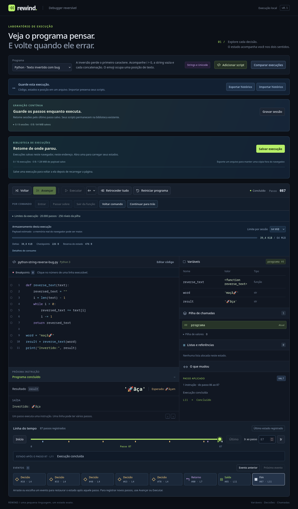

# Strings Python reversíveis

O subconjunto Python agora aceita valores `str`. Escolha **Python · Hello, world!**, **Python · Texto invertido com bug** ou **Python · Texto invertido corrigido** no seletor. O editor e os arquivos `.py` usam a mesma implementação.



## Uma inversão que perde um caractere

```python
def reverse_text(text):
    reversed_text = ""
    i = len(text) - 1
    while i > 0:
        reversed_text += text[i]
        i -= 1
    return reversed_text

word = "maçã🚀"
result = reverse_text(word)
print("Invertido:", result)
```

O resultado com bug é `🚀ãça`; o correto é `🚀ãçam`. A condição `i > 0` omite a posição zero. Na comparação, a versão corrigida já fica selecionada como execução B. **Primeira diferença** mostra a decisão no limite do loop. Avançar registra a concatenação; voltar restaura exatamente o texto anterior e os operandos. A string permanece imutável: `+=` atribui outro valor ao binding.


O debugger apresenta strings entre aspas, com escapes e tipo `str`; `print` mostra o conteúdo sem aspas. Os previews de valores limitam textos extensos a cerca de 160 unidades UTF-16, sem truncar o valor da VM ou o arquivo exportado. Strings dentro de listas usam representação com aspas. A saída extensa continua com [páginas e download completo](transfers-and-output.md).

## Operações disponíveis

| Recurso | Exemplo | Resultado |
| --- | --- | --- |
| Aspas simples e duplas | `'ação'`, `"Hello, world!"` | String |
| Literais adjacentes | `"a" 'b'` | `"ab"` |
| Concatenação / atribuição | `text + "!"`, `text += "!"` | Novo texto |
| Repetição por `int`/`bool` | `"ab" * 3`, `2 * "🚀"` | `"ababab"`, `"🚀🚀"` |
| Índices negativos e `bool` | `"a🚀é"[-2]`, `"ab"[True]` | `"🚀"`, `"b"` |
| Comprimento | `len("a🚀é")` | `3` |
| Verdade e curto-circuito | `bool("")`, `"" or "fallback"` | `False`, `"fallback"` |
| Igualdade / ordem | `"a" == 1`, `"🚀" > "\ue000"` | `False`, `True` |
| Conversão para texto | `str()`, `str(42)`, `str(["a"])` | `""`, `"42"`, `"['a']"` |

Aceita `\\`, `\'`, `\"`, `\a`, `\b`, `\f`, `\n`, `\r`, `\t`, `\v`, `\xhh`, `\uhhhh`, `\Uhhhhhhhh` e escapes octais de até três dígitos entre `000` e `377`. Comentários e delimitadores dentro de aspas são texto; aspas e colchetes dentro de comentários são ignorados. Literais podem ser concatenados implicitamente dentro de parênteses, inclusive entre linhas, preservando posições no arquivo original e CRLF.

As regras seguem o subconjunto das [strings e escapes do Python](https://docs.python.org/3/reference/lexical_analysis.html#string-and-bytes-literals) e das [sequências de texto](https://docs.python.org/3/library/stdtypes.html#text-sequence-type-str). `len`, índices e ordenação usam pontos de código Unicode, sem normalização. Um emoji ocupa uma posição; `e` seguido de acento combinante ocupa duas. Não há promessa de contar grafemas visuais.

Limitações explícitas: aspas triplas, prefixos (`r`, `u`, `b`, `f`), f-strings, bytes, escapes desconhecidos/nomeados, continuação de uma string por barra invertida, métodos de texto, slicing e `%` para formatação ainda não estão implementados. Surrogates isolados e escapes de surrogate são recusados: esta versão aceita valores escalares Unicode. `int` e `float` continuam aceitando valores numéricos; conversão a partir de string é uma evolução separada. `str` aceita zero ou um argumento, com os mesmos aliases/sombreamento dos demais builtins. Representações descritivas de funções não reproduzem endereços de memória do CPython.

## Quotas e falhas atômicas

Cada string tem até **100.000 unidades UTF-16**: até 100.000 caracteres ASCII ou 50.000 emojis fora do BMP. O teto limita armazenamento, independentemente do comprimento Python. Concatenação e repetição verificam o tamanho antes da alocação do resultado; contagens negativas ou repetição de texto vazio produzem string vazia. Literais e valores importados também passam pela validação, inclusive Unicode.

`print` mantém sua quota de 100.000 unidades, incluindo separadores e quebra de linha. Representações escapadas de listas também contam nesse teto. Excesso gera erro reversível, sem saída parcial. Índice inválido, mistura de tipos, tentativa de alterar um caractere ou operação não suportada desfazem os operandos consumidos antes de registrar somente a mudança de controle para erro. Reaplicar esse passo usa o delta, sem avaliar a expressão outra vez.

Os orçamentos de payload, disco, histórico, heap e checkpoints permanecem. Os valores de string são imutáveis; deltas de binding guardam antes/depois, e deltas de operandos/frames/listas incluem os valores necessários. Não é criada uma cópia de toda a VM por instrução. Strings inteiras podem reaparecer nos deltas e serializações; concatenações sucessivas ainda têm custo proporcional ao texto, sujeito ao orçamento. Não há deduplicação global de strings nesta entrega.

## Compatibilidade

O codec JSON já transportava texto em fontes, nomes e saída. Os novos valores usam strings JSON normais, sem uma tag que possa colidir com conteúdo como `$bigint`. A mudança de tipos/semântica é declarada por **`rewind-vm/3`**.

| Identidade | Histórico existente / sem recursos de texto | Programa com strings ou leitura de `str` |
| --- | --- | --- |
| VM/valores | `rewind-vm/2` | `rewind-vm/3` |
| Envelope até 20.000 passos | v2 | v2 |
| Envelope com limite ampliado | v3 | v3 |
| Manifesto até 20.000 / ampliado | v1 / v2 | v1 / v2 |
| Fonte de journal até 20.000 / ampliado | v1 / v2 | v1 / v2 |
| Schema IndexedDB | v1 | v1 |
| Validação auxiliar do journal | identidade `/1` | identidade `/2` |

A versão de envelope continua identificando os limites de execução; o campo `vm` identifica os tipos e a semântica. Leitores aceitam VM2 e VM3. Programas sem literais string nem leitura de `str` continuam escrevendo VM2; `Program.vm` só é incluído nos programas VM3. Não há migração destrutiva nem alteração do formato dos scripts salvos. Aplicações anteriores recusam VM3 explicitamente.

Ao ler VM2, o compilador usa o perfil legado, preserva o hash e a ausência do builtin `str`. Isso importa para arquivos anteriores que usavam uma variável chamada `str` ou registraram erro ao tentar chamar esse nome inexistente. A reexecução de uma sessão importada mantém seu perfil. Para adotar os novos recursos, edite/aplique o código ou abra uma sessão nova. O perfil acompanha os cabeçalhos dos Workers, materialização, capturas e retomadas. Downgrade de uma fonte com literais string para VM2 e versões futuras desconhecidas são recusados.

O cache de validação e os checkpoints graváveis separam suas identidades por perfil, preservando os caches legados. Capturas paginadas continuam vinculadas ao checksum do manifesto. Estados, strings e contadores são validados antes da publicação.

## Validação e reprodução

`tests/python-strings.test.ts` cobre literais, escapes, posições, Unicode, igualdade/ordem, repetição, aliases, verdade, funções/recursão, listas/ciclos, impressão, quotas e erros atômicos. Sequências geradas percorrem destinos nos dois sentidos e comparam todos os campos da VM. Uma verificação opcional compara saída com `python3` existente; não instala Python.

A fixture [pre-strings-vm2.json](../tests/fixtures/pre-strings-vm2.json) foi produzida antes da implementação, com o commit `d62d861`. Guarda arquivos/checksums/hashes e estados de referência para três programas, incluindo `str` sombreado e inexistente. Os testes verificam leitura, reexportação e reinício sem alterar os estados antigos. Arquivos, biblioteca, paginador e journal VM3 são testados nos limites padrão e ampliado, com validação integral e prefixo reutilizado.

No Firefox 150.0 instalado, o ensaio de 393 instruções conferiu **1.182 estados completos**, futuro volátil, importação e biblioteca por Workers, comparação journal/captura, prefixo VM3 e os três arquivos VM2. A UI verificou Hello World, bug/correção, tipo/cor de strings, arquivo baixado e reimportado, captura paginada/materialização e largura de 390 px sem overflow. [Relatório](python-strings-browser.json) e [captura móvel](python-strings-mobile.png). São verificações de correção; não são um benchmark de memória ou desempenho.

```bash
npm run check
npm run build
npm run test:firefox -- --strings-only
npm run test:firefox
```

Os testes usam o navegador instalado e um perfil do projeto. Os artefatos gerados ficam em `.artifacts/`; não alteram scripts do perfil pessoal nem componentes globais.
