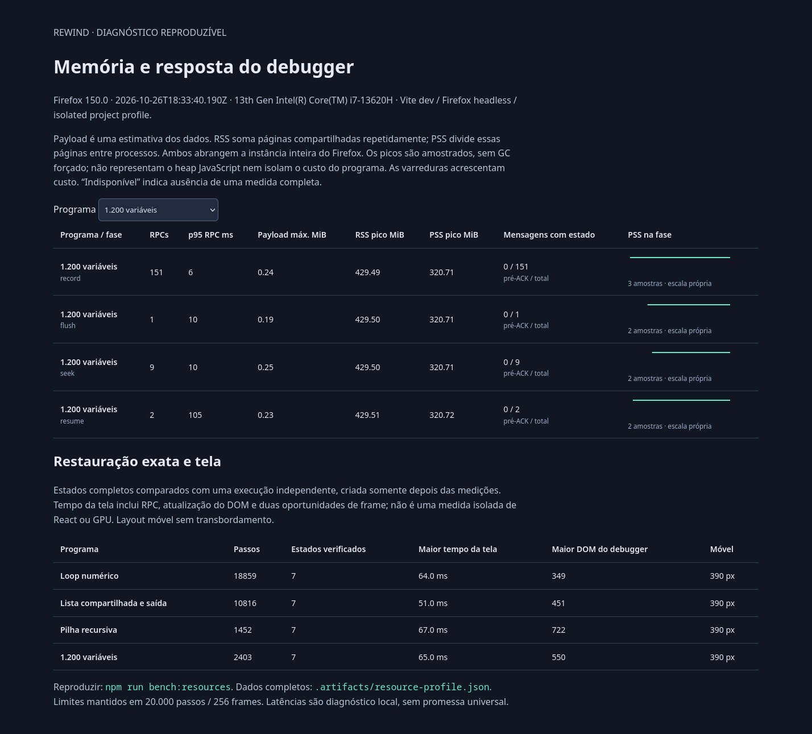

# Perfil de recursos e redução de cópias

O comando `npm run bench:resources` executa quatro programas no Firefox instalado, usando IndexedDB e os Workers da aplicação. Mede gravação, flush, saltos e retomada, verifica os estados completos e exercita a interface em desktop e 390 px. Não instala componentes, não baixa browsers e não altera o perfil pessoal.

- [Relatório interativo independente](resource-profile.html): filtro por programa, fases, mensagens e curvas de PSS; abre diretamente no navegador, sem servidor ou serviços externos.
- [Dados completos da medição](resource-profile.json), incluindo amostras e limites.
- [Referência anterior à otimização](resource-profile-before.json).



## Como reproduzir

```bash
npm run bench:resources
```

O comando executa os testes do amostrador, abre uma instância headless isolada e gera `.artifacts/resource-profile.json`, `.artifacts/resource-profile.html` e capturas. Usa as mesmas portas/configurações do [smoke test](../README.md#verificações). A medição é optativa: a suíte comum não precisa repeti-la. Linux disponibiliza as medidas dos processos por `/proc`; em outro sistema o fluxo continua, mas memória fica indisponível. Falta de permissão, processo encerrado durante a leitura ou árvore incompleta produz `null`, nunca um zero fictício.

Os programas estão em `scripts/resource-browser-probe.mjs`. As condições são fixas: cache de 64 KiB, buffer de 32 KiB, orçamento lógico de 64 MiB, até 20.000 instruções e 256 frames. Cada gravação usa pedidos aceitos de até 16 instruções. Os saltos percorrem início, fim, quartos, meio e cursores vizinhos. A retomada fecha e reabre o mesmo journal.

O oráculo só é criado **depois** das fases de recursos: compara sete destinos únicos por programa, incluindo controle, frames/locais, operandos, saída e heap/IDs. Seu histórico integral não fica retido durante essas fases. A interface é medida separadamente, depois da verificação; o GC pode ainda conservar memória do oráculo. Cada execução do comando usa um perfil novo; os quatro programas compartilham a instância, sequencialmente, sem GC forçado.

## O que cada medida representa

| Medida | Significado e limite |
| --- | --- |
| Payload estimado | Contadores determinísticos de cache, índice e reservas. Máximos observados depois das respostas, não todas as alocações intermediárias. |
| RSS | Soma de `VmRSS` do Firefox isolado e seus descendentes. Páginas compartilhadas podem ser contadas mais de uma vez. Não inclui Node/Vite. |
| PSS | Soma de `Pss` de `smaps_rollup`; páginas compartilhadas são divididas entre processos. Abrange a instância inteira do Firefox, incluindo engine, JIT, GC e gráficos. |
| Memória privada | Soma de `Private_Clean + Private_Dirty`, disponível no JSON; também é da instância inteira. |
| Amostras | Varreduras sem sobreposição, separadas por pelo menos 150 ms, mais início/fim de fase; o JSON contém duração de cada varredura. A árvore não é lida atomicamente. |
| Pico amostrado | Maior amostra completa. É um limite inferior do pico real; fases curtas frequentemente têm só duas amostras e podem ocultar temporários. Não mede o heap JS isolado. |
| RPC | Tempo na página entre pedir uma operação e receber seu estado aceito. Inclui ACK, cópia, execução/replay, codec, eventuais acessos ao banco e transporte. `resume` contém dois RPCs: fechar e reabrir. |
| Timer de 20 ms | Intervalo efetivo entre callbacks da página durante as fases da API. Não é tempo de CPU do Worker ou latência do input da UI. |
| Tela | Pedido de salto até cursor publicado/indicador de trabalho encerrado e duas oportunidades de `requestAnimationFrame`. Inclui RPC, atualização do DOM e espera dos frames; não isola React ou pintura da GPU. |
| Mensagens com estado | Mensagens recebidas pelo cliente com o estado completo da VM. Não conta todas as cópias internas de estado, codec, checkpoints ou IndexedDB, nem mede bytes do structured clone. |

O benchmark acrescenta observação e varreduras. A latência ainda depende da máquina, carga, compilação inicial, caches e decisões de GC. Diferenças entre programas ou duas rodadas não isolam a memória atribuível ao debugger nem demonstram redução proporcional de RAM. O relatório informa ambiente e amostras para permitir avaliar esses limites.

## Resultado local

Firefox 150.0, Linux x64, i7-13620H, 16 CPUs disponíveis, aproximadamente 15,3 GiB de RAM, servidor Vite de desenvolvimento e viewport 1440 × 1100. Dados capturados em 26/10/2026; o build estático é validado separadamente.

| Programa | Passos | p95 RPC de gravação | p95 RPC de salto¹ | Maior resposta da tela² | Maior DOM do debugger |
| --- | ---: | ---: | ---: | ---: | ---: |
| Loop numérico | 18.859 | 6 ms | 10 ms | 64 ms | 349 elementos |
| Lista compartilhada e 600 saídas | 10.816 | 8 ms | 5 ms | 51 ms | 451 elementos |
| Recursão, até 121 frames observados | 1.452 | 8 ms | 10 ms | 67 ms | 722 elementos |
| 1.200 variáveis | 2.403 | 6 ms | 10 ms | 65 ms | 550 elementos |

¹ Nove saltos: com tão poucas amostras, p95 coincide com o máximo. ² Seis saltos na interface, incluindo RPC e duas oportunidades de frame.

O maior intervalo do timer durante gravação foi 22 ms. Payload máximo observado entre as fases ficou entre **0,19 e 0,38 MiB**, enquanto o PSS da instância inteira chegou a **500,77 MiB** no caso numérico. Esses números medem conjuntos diferentes. O perfil sozinho não permite atribuir esse PSS aos registros ou liberar um teto de RAM equivalente ao orçamento de payload.

Não há asserções frágeis de tempo/RAM para hardware arbitrário. Como referência local de investigação, p95 de lotes acima de 50 ms, saltos da tela acima de 100 ms ou intervalos de timer acima de 100 ms merecem repetição e análise; não são uma promessa de produto. Antes de alegar melhoria de tempo/memória, repetir ao menos cinco vezes por revisão/ambiente e comparar distribuições e piores casos, incluindo inicialização fria.

## Otimização comprovada pelo perfil

Antes, a mensagem `prepared` carregava um snapshot completo que o cliente não consumia: a decisão de ACK depende apenas do ID atual e do cancelamento. O mesmo estado voltava a atravessar o canal em `state`.

Agora os três atores — gravação contínua, captura paginada e comparação — enviam somente `{ id, kind: 'prepared' }`. Estados privados e validações continuam no Worker. O cliente confirma o pedido atual e recebe o estado/par completo depois do commit. O lote aceito, a fila limitada e o ponto de cancelamento permanecem iguais. Banco e arquivo v2/VM2 continuam compatíveis.

| Gravação | Mensagens completas antes | Depois |
| --- | ---: | ---: |
| Loop numérico, 1.179 lotes | 2.358 | 1.179 |
| Lista/saída, 676 lotes | 1.352 | 676 |
| Recursão, 91 lotes | 182 | 91 |
| Variáveis, 151 lotes | 302 | 151 |
| **Total** | **4.194** | **2.097** |

A redução de **50% das mensagens com estado completo** nesses lotes é determinística. Não implica 50% menos bytes totais, RAM ou tempo. A referência anterior serve para essa contagem; os tempos da retomada mudaram de instrumentação e não devem ser comparados diretamente.

## Garantias verificadas e próximo passo

- Nenhum estado completo na preparação; um estado publicado por RPC aceito nas quatro fases.
- Sete estados completos por programa iguais ao oráculo independente, incluindo replay e retomada, sem alteração do número de passos.
- Cache/payload dentro dos limites após cada resposta; nenhum histórico integral transferido para explicar/navegar.
- DOM do debugger abaixo de 2.000 elementos, mesmo com 1.200 locais; layout de 390 px sem transbordamento. O relatório HTML também é aberto e seu filtro testado no Firefox.
- Suíte existente preservada: cancelamento precisamente antes/depois do ACK, destinos concorrentes, fronteira parcial, comparação publicada como par, reserva de leitura, quota/corrupção e retry sem duplicação. Os testes nativos verificam o ACK sem payload nos atores de captura/contínuo/comparação.
- Testes do amostrador verificam somas, dados ausentes, árvore incompleta, plataforma sem `/proc`, varreduras sem sobreposição e duração incluindo a última amostra.

Este marco entrega um perfil inicial reproduzível e elimina uma cópia comprovadamente desnecessária. O próximo ensaio deve explorar estados/checkpoints e transações individuais grandes, erros de armazenamento durante esses casos e variações de inicialização fria. Só então ampliar sessões com contratos de quotas e compatibilidade explícitos. Os 20.000 passos e todo o histórico inicial/futuro foram mantidos; nenhuma política de descarte foi introduzida.
