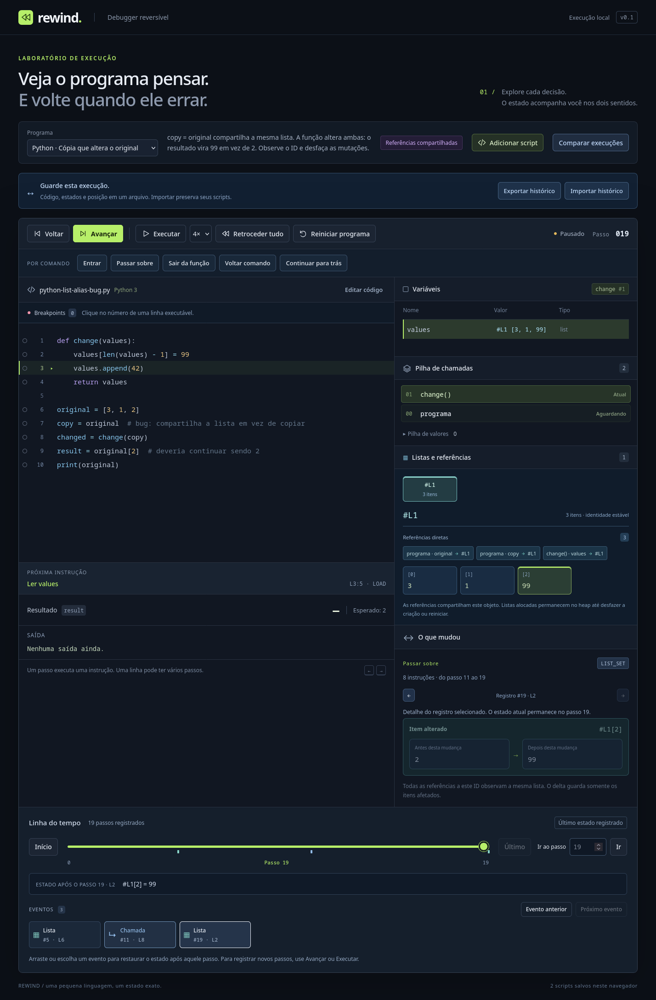
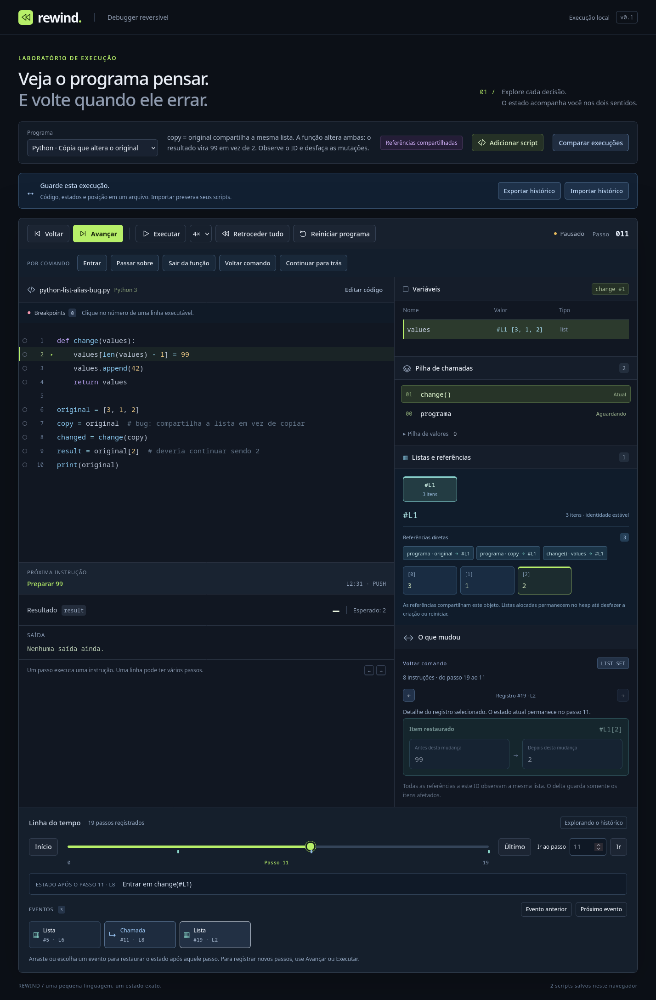

# Listas Python e heap reversível

O painel **Listas e referências** mostra os objetos do heap no cursor atual. Variáveis guardam IDs como `#L1`; o objeto mantém seus itens. Compartilhar uma referência não duplica a lista. Mudar um item atualiza o que todos os aliases observam, também ao voltar.



## Explorar a demo

1. Escolha **Python · Cópia que altera o original**.
2. Use **Entrar** para definir `change`, depois **Passar sobre** para criar `original` e atribuir `copy`. Ambos apontam para `#L1`, com `[3, 1, 2]`.
3. Use **Entrar** na chamada. O parâmetro `values` também aparece entre as referências diretas.
4. **Passar sobre** escreve `99` no último item. O painel mostra a mudança `2 → 99`; **Voltar comando** restaura `2` para todas as referências.
5. Reaplique e passe pelo append. Voltar esse comando remove `42`; não recalcula a lista anterior.
6. **Sair da função** remove o frame; **Voltar** restaura seus locais apontando para o mesmo objeto.
7. Execute até concluir com `99` e saída `[3, 1, 99, 42]`. Compare com **Python · Cópia independente**, que retorna `2` e imprime `[3, 1, 2]`.



A primeira divergência da comparação é a alocação extra da cópia em B. O ponto seguinte evidencia que `original`/`copy` compartilham um objeto somente em A. Depois, as mutações e resultados divergem.

O exemplo **Python · Uma lista aponta para si** cria um ciclo com `items.append(items)`. `print` usa `[...]` no caminho cíclico. O botão do item permite seguir a referência; inspecionar objetos não muda o cursor.

## Escopo Python

```python
def change(values):
    values[-1] = 99
    values.append(42)
    return values

original = [3, 1, 2]
copy = original
changed = change(copy)
result = original[2]
print(original)
```

Literais aceitam aninhamento, vírgula final e continuação multilinha entre colchetes. Índices aceitam `int` e `bool`, inclusive negativos; float, mesmo integral, é rejeitado. Índices fora do intervalo geram erro atômico e reversível. A escrita avalia RHS antes do alvo/índice. Append verifica o receptor antes do argumento, usa um argumento posicional e retorna `None`.

`len` aceita uma lista; `bool`, `not`, condições e curto-circuito usam seu comprimento atual. `==`/`!=` comparam conteúdo, com regras numéricas de Python; aliases do mesmo objeto comparam iguais. Comparações que recursam entre ciclos distintos falham explicitamente. O debugger compara a topologia de referências entre execuções, uma informação adicional à igualdade de conteúdo da linguagem.

Não há slicing, concatenação/repetição, comparação de ordem, `is`, atribuição aumentada por índice, métodos armazenados, outros métodos, comprehensions ou `for`. A identidade de objetos float do CPython não é modelada; por exemplo, o atalho de identidade de um NaN dentro de listas distintas não é reproduzido. Strings e outras coleções continuam fora deste subconjunto. [Especificação Python completa](python.md).

## Estado e inversão

```ts
type ListReference = { readonly kind: 'list'; readonly id: number };
type Heap = Record<number, { kind: 'list'; items: Value[] }>;

// Criação: undo remove o objeto; replay recria seu conteúdo inicial.
{ kind: 'heap-allocation', id: 1, object: { kind: 'list', items: [3n, 1n, 2n] } }

// Escrita: undo troca added por removed no mesmo objeto.
{ kind: 'heap-splice', id: 1, index: 2, removed: [2n], added: [99n] }

// Append: undo remove o único item adicionado.
{ kind: 'heap-splice', id: 1, index: 3, removed: [], added: [42n] }
```

Controle inclui `nextObjectId` e `heapItems`; undo restaura esses contadores. Os deltas são congelados e não guardam o objeto mutável ativo. Referências são valores por ID, permitindo ciclos sem recursão no codec. Checkpoints clonam o heap completo esparsamente; cada VM/fork mantém suas próprias listas mutáveis.

`seek`, replay, explicações e comparação de gravações não executam instruções. Explicações usam valores dos deltas e IDs, sem expandir uma referência usando conteúdo posterior. Decisões usam o caminho registrado no controle: uma lista vazia pode ter recebido itens depois, sem alterar a explicação da condição anterior.

O envelope passou para **v2 / rewind-vm/2**. A validação confere objetos existentes, IDs sequenciais, contadores, alvo/índice, valores anteriores de splices e ausência de referências pendentes. Arquivos v1 são recusados com indicação da branch `feat/portable-histories`; não há migração automática. Scripts salvos permanecem no formato anterior da biblioteca, independente do histórico.

## Limites e armazenamento

São permitidas **4.096 listas** e **20.000 itens totais** entre todos os objetos alocados. Ainda não há coleta de lixo; perder a última referência não libera um objeto. Desfazer sua criação ou reiniciar remove-o. Quotas recusam crescimento com erro reversível, sem truncar itens.

`print` tem teto de **100.000 caracteres por chamada**, incluindo separadores e quebra de linha. A expansão de grafos compartilhados é iterativa e limitada; excesso falha atomicamente. A paginação do painel mostra até oito listas, 16 itens e 12 referências por página. Previews mostram até seis itens, preservando identidade; o inspetor permite consultar todos. Linhas de fonte muito longas mantêm o texto integral sem milhares de spans de coloração.

O histórico mantém o limite de 20.000 passos, checkpoints a cada 128 passos inicialmente e até 128 cópias. Não há cópia completa por mutação, mas alocações custam o tamanho inicial da lista e checkpoints custam o estado completo. Retenção por bytes e carregamento em disco continuam como próximo marco.

## Testes e medidas

```bash
npm run check
npm run build
npm run test:firefox
npm run bench:heap -- --output docs/heap-benchmark.json
```

Os testes comparam todo o estado em cada cursor nos dois sentidos e em saltos gerados (seed `20261013`): heap, referências, IDs, contadores, frames, operandos, controle e saída. Cobrem ciclos, aliases em parâmetros/retornos, erros, quotas, forks/checkpoints, arquivos v2, corrupção com checksum recalculado e fixture real v1. A comparação opcional com o Python instalado verifica saída, índices, verdade, compartilhamento e ordem de avaliação.

O Firefox instalado verifica a demo, mutação/append desfeitos, retorno restaurado, comparação 99/2, autorreferência, importação v2, rejeição v1 preservando a sessão e lista de 3.000 itens com 16 células no DOM. O perfil/downloads ficam isolados no projeto. Chromium/WebKit têm fluxos preparados, sem downloads ou execução nesta máquina.

[Diagnóstico do núcleo](heap-benchmark.json), Node 24.18.0, 500 escritas e 100 buscas após dez de aquecimento. Cada destino é comparado com uma execução independente; tempos excluem as asserções. Só os destinos selecionados ganham snapshots de referência.

| Itens | Passos | Delta de uma mutação | Checkpoints | Payload de checkpoints | Seek p95 |
| ---: | ---: | ---: | ---: | ---: | ---: |
| 8 | 7.523 | 93 bytes | 59 | 28.964 bytes | 0,038 ms |
| 2.000 | 9.515 | 93 bytes | 75 | 2.182.243 bytes | 0,227 ms |

Os 93 bytes medem somente o splice de heap codificado, sem os operandos/controle/metadados da transação. Os demais bytes são payloads codificados, não memória real do JavaScript. As medições são diagnósticos locais, sem DOM, e não garantias de latência. O custo maior dos checkpoints com listas grandes motiva medir um orçamento de armazenamento antes de ampliar sessões.
