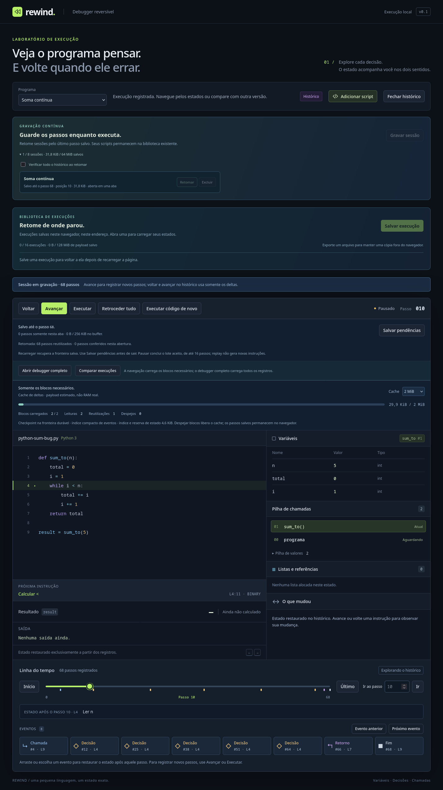

# Retomada por prefixos validados

**Retomar** reutiliza o prefixo que já foi produzido ou validado pelo interpretador e confere somente os blocos que vieram depois. A tela informa quantos passos foram reutilizados e quantos foram conferidos nesta abertura. O cursor e o futuro continuam restaurados exatamente pelos mesmos deltas, sem executar novamente o código.

Na biblioteca de sessões, marque **Verificar todo o histórico ao retomar** para ignorar o cache e conferir todos os registros desde o início. Essa opção é útil para verificar a integridade completa dos blocos, inclusive daqueles que você não vai visitar agora.



## Identidade e contrato

O journal original continua **v1**, sem migração ou alteração de seus arquivos. Seu banco auxiliar **`rewind.recording-journal.validation-cache` v1** contém um catálogo leve e um checkpoint/índice por sessão. São até **16 entradas / 64 MiB**, com **8 MiB por entrada**. O catálogo evita carregar os checkpoints de outras sessões ao verificar quotas ou despejar dados antigos.

Cada prefixo registra:

- Versão do validador, atualmente `rewind-journal-validator/1`.
- ID da sessão e checksum da fonte, que fixa código, programa compilado, runtime, VM, limites e estado inicial.
- Fronteira numa borda de bloco e selo correspondente na cadeia do journal.
- Estado codificado nessa fronteira, índice compacto de eventos e máximos de payload de estado/delta.

Conteúdo e tamanho do cache são verificados por SHA-256/UTF-8, além da validação estrutural do checkpoint e dos eventos. O selo precisa pertencer à cadeia atual; um checkpoint na fronteira atual deve coincidir com o checkpoint do journal. A identidade do validador deve mudar se suas regras de aceitação mudarem.

O prefixo é publicado somente **depois** do commit durável ou depois de uma validação concluída. Ele cobre um segmento contínuo desde a origem, sem lacunas. O cache é substituído atomicamente; publicações atrasadas não substituem um prefixo mais avançado. Não há um certificado independente para cada salto arbitrário.

## Retomada e falhas

1. Valida fonte, programa, cabeça, descritores e encadeamento do journal.
2. Procura um prefixo compatível e verifica seu checkpoint/índice. Ausência, versão incompatível ou corrupção levam à validação pela origem.
3. Reconstitui a VM na fronteira reutilizada e aplica/valida o sufixo, um bloco de cada vez. A projeção de eventos e os contadores continuam a partir do prefixo.
4. Compara o estado final com o checkpoint durável e só então assume o escritor, por revisão/lease, e restaura o cursor salvo.
5. Atualiza o cache derivado. Se houver divergência após reutilizar um checkpoint antigo, tenta uma vez desde a origem; corrupção dos blocos originais continua sendo recusada.

Cancelar antes da conclusão não assume o escritor nem publica um prefixo incompleto. Falta de espaço no cache auxiliar **não desfaz** um commit válido no journal e não bloqueia a execução: a próxima abertura pode conferir mais passos. Despejos removem apenas dados derivados. Exclusão da sessão também tenta remover seu cache; falhas nessa limpeza não ressuscitam a sessão nem removem outros dados.

Os checksums detectam corrupção e vinculam os dados às identidades esperadas; não são assinaturas contra um agente que consiga reescrever todos os bancos e hashes locais. A reutilização pressupõe os blocos imutáveis já aceitos pelo validador. Cada bloco continua tendo seu checksum verificado quando é lido; uma corrupção posterior num bloco antigo pode ser descoberta somente ao visitá-lo ou ao pedir a conferência integral. Reabrir com cache não é uma auditoria integral do disco.

**Zero blocos na validação não significa zero I/O.** Ainda são lidos metadados/cache, e restaurar um cursor anterior ou mostrar sua última instrução pode ler blocos do histórico. A primeira retomada de um journal anterior, sem cache derivado, precisa conferir o prefixo inteiro. Gravações novas já deixam o prefixo preparado após os commits.

## Medidas reproduzíveis

```bash
npm run check
npm run bench:segments -- --output .artifacts/segment-benchmark.json
npm run test:firefox -- --live-only
npm run test:firefox
```

O benchmark cobre loop escalar, muitos locais, listas compartilhadas/saída e recursão com erro. Confere estados completos nos dois sentidos com referência sequencial e compara retomada sem cache, com cache completo e com cache antigo. [Relatório desta entrega](segment-benchmark.json).

Uma amostra local desta entrega, com buffer de 16 KiB e cache de 8 KiB:

| Perfil | Passos | Retomada sem cache | Com prefixo completo | Pico de payload reservado |
| --- | ---: | ---: | ---: | ---: |
| Loop escalar | 2.089 | 80,45 ms | 3,12 ms | 64.756 bytes |
| Muitos locais | 1.217 | 95,10 ms | 6,11 ms | 74.710 bytes |
| Heap compartilhado e saída | 2.652 | 232,68 ms | 20,90 ms | 103.451 bytes |
| Recursão e erro | 120 | 20,75 ms | 1,85 ms | 33.331 bytes |

São amostras únicas, sujeitas a carga/JIT/GC. O cache menor que um bloco também exercita leituras isoladas sem retenção.

O relatório mede tempo de gravação/retomada/saltos, leituras para validação, pico amostrado de buffer e payload reservado. As amostras de heap/RSS pertencem ao processo inteiro — Vite, fake-indexeddb, retenção de objetos e GC incluídos — e não isolam RAM da VM. A emulação do banco não mede latência do disco real. As reservas contabilizam VMs de fronteira/cursor/staging, índices, buffer e cache; fonte, objetos do compilador, codec transitório e DOM têm custos adicionais. Esses números são diagnóstico local, sem promessa de latência ou limite físico de RAM.

O Firefox instalado verifica IndexedDB e Worker reais: restauração exata, indicador de prefixo reutilizado, checkbox de conferência integral, comparação e layout de 390 px. O cliente RPC compara a execução de 777 passos com uma referência, alternando retomada com cache e validação integral no mesmo cursor 7. Um prefixo antigo de 238 passos é reutilizado enquanto apenas os 539 passos restantes são conferidos; o estado final coincide com a referência. [Relatório no navegador](segment-validation-browser.json).

Os **20.000 passos / 256 frames** permanecem. O marco seguinte implementou checkpoints intermediários e **Comparar gravações**, com leitores paginados para sessões/capturas persistidas. O comparador de fontes continua integral. [Contrato e demo](streaming-comparison.md). Nenhum passo inicial ou futuro é removido automaticamente.
