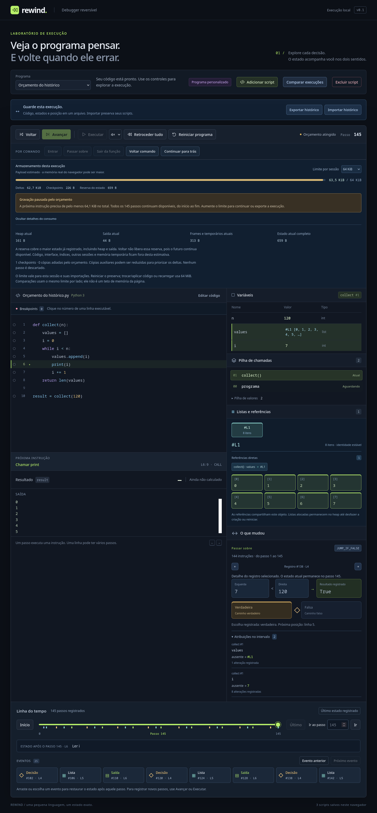

# Orçamento do histórico

Cada sessão reserva até **64 MiB de payload estimado** por padrão. O painel **Armazenamento desta execução** mostra deltas, checkpoints e reserva do estado, com limite ajustável. Ao recusar uma instrução nova, a gravação pausa no último estado válido. Todos os passos registrados continuam disponíveis, do início ao fim.



## Experimentar

1. Escolha **Python · Crescimento do histórico** e selecione **64 KiB** em **Limite por sessão**.
2. Clique em **Entrar** para definir a função; depois em **Passar sobre** para executar a chamada.
3. A gravação pausa com **Orçamento atingido**, dentro de `collect`, mantendo suas variáveis, lista, operandos e saída.
4. Use **Início** e **Último**. O total reservado permanece igual: o futuro gravado ainda existe.
5. **Detalhes do consumo** mostra heap/saída/frames atuais e a reserva do maior estado observado.
6. Selecione **4 MiB**, clique em **Sair da função** e depois **Executar**. O programa conclui com `120`, sem duplicar registros ou saída.
7. Também é possível exportar no momento da pausa e reabrir a gravação parcial. Aumentar o limite de um arquivo parcial não inventa passos novos; **Executar código de novo** cria outra execução da fonte.

Reiniciar limpa registros, checkpoints, métricas e pausa, preservando o limite escolhido e os scripts. Trocar/aplicar código ou recarregar cria uma sessão com 64 MiB. O limite não é salvo na biblioteca de scripts nem no arquivo v2. Importações usam o limite capturado ao iniciar a transferência; comparações usam o limite escolhido por lado. Históricos importados que já excedem esse limite são recusados integralmente, sem truncar dados ou substituir a sessão aberta.

## O que os bytes significam

```text
total reservado = deltas + checkpoints retidos + maior estado observado
```

Valores usam tamanho UTF-8 da representação com tags para `bigint`, `-0`, NaN e infinitos. Referências de lista são IDs; ciclos não expandem os objetos. Coleções reservam um delimitador por entrada, inclusive a última: a medida estrutural fica ligeiramente acima do JSON equivalente, permitindo atualização incremental sem depender do estado inteiro.

A reserva do maior estado inclui controle, frames/bindings, operandos, heap e saída. Ela não diminui ao retroceder ou ao retornar de uma função, porque estados maiores continuam no histórico. Os detalhes do estado atual estão incluídos nessa reserva e não devem ser somados outra vez ao total.

Esta medida **não é o heap real do JavaScript nem um teto de RAM da página**. Exclui código compilado/fonte, índices, UI, overhead dos objetos, strings temporárias, Workers, outras sessões e cópias simultâneas durante transferências. Forks compartilham payloads congelados, mas cada sessão mantém seu próprio orçamento e VM; não existe ainda um orçamento agregado da página. Quotas de arquivos (32 MiB por arquivo, até oito/64 MiB abertos) continuam independentes.

## Admissão, checkpoints e reversibilidade

`storage-accounting.ts` atualiza os contadores somente pelos valores já presentes nos deltas, nos dois sentidos. O estado completo é medido ao iniciar/restaurar um checkpoint. Não há varredura de todo o heap nem serialização de todo o histórico a cada instrução.

`CheckpointHistory.append` planeja a admissão antes de alterar registros/índices:

1. Conta a transação candidata e a nova reserva do estado.
2. Se deltas + checkpoint inicial + reserva excedem o limite, recusa atomicamente.
3. Se necessário, remove checkpoints auxiliares mais antigos para dar espaço aos deltas. O checkpoint inicial e todos os registros permanecem.
4. Aplica a política existente de espaçamento/teto de checkpoints; uma nova cópia só é criada se couber. Cópias adiadas são contabilizadas.

A VM calcula uma única instrução candidata para descobrir seus deltas. Ao recusar, `DebugSession` aplica sua inversa imediatamente: estado, cursor, IDs, contadores de listas, frames, operandos e saída voltam exatamente ao anterior. Essa tentativa usa memória temporária fora da estimativa; os limites existentes da linguagem continuam valendo. Não há efeitos externos nesta linguagem.

`recordingStop` é uma pausa do debugger, separada de `MachineState.control.status`: não fabrica erro do programa. Replay/seek continuam aplicando registros sem executor e sem nova admissão. Aumentar o limite suficiente remove a pausa; reduzir abaixo do total já reservado é recusado sem remover cópias ou passos. O maior limite configurável é 256 MiB de payload; a interface começa em 64 KiB para a demo.

Comparações identificam a parada como **Limite da gravação**, preservando os pontos navegáveis. O codec permanece v2/VM2: a política de orçamento não altera a semântica do programa ou os deltas. Arquivos parciais guardam fonte, registros e cursor; não guardam o motivo/política da pausa. Checkpoints são reconstruídos conforme o orçamento local.

## API

```ts
const session = new DebugSession(source, {
  language: 'python', maxHistoryBytes: 64 * 1024,
});
const controller = new ExecutionControl(session);
controller.start('continue');
while (controller.running) controller.runBatch(256); // yield entre lotes na UI

console.log(session.storageStats, session.machinePayload, session.recordingStop);
session.seek(0); // O futuro permanece reservado.
session.setHistoryBudget(4 * 1024 * 1024);
controller.start('continue'); // Replay existente, depois gravação nova.
```

`forward()`/`runBatch()` do núcleo lançam `HistoryBudgetError` na primeira recusa; o estado já foi restaurado. Depois dela, `canForward` é falso somente na fronteira gravada e `forward()` retorna `null`. `ExecutionControl` converte a recusa em parada `budget` e conserva o intervalo efetivamente aplicado. `importHistory(content, { maxHistoryBytes })` valida a gravação inteira em uma sessão privada e recusa falta de orçamento antes de publicá-la.

## Verificações e custo

```bash
npm run check
npm run build
npm run test:firefox
npm run bench:storage -- --output docs/storage-benchmark.json
```

Os testes cobrem fronteira exata/um byte abaixo, alocação, escrita, append, chamada/retorno, saída e erro recusados; contadores incrementais versus estado reconstruído; saltos gerados (seed `20261013`), checkpoint reduzido, reserva estável, aumento/redução/reinício, forks, comparação limitada e importação v2 parcial. Uma spy verifica ausência de varredura completa por instrução e outra garante replay sem executor.

O Firefox instalado verificou a pausa em 64 KiB, navegação nas duas pontas, reserva estável, exportação parcial, importação recusada preservando scripts, retomada até 120, saída sem duplicação, reinício, recarga e layout de 390 px. Perfil/downloads ficam somente no projeto. Os fluxos Playwright continuam preparados para os outros engines, sem baixar navegadores.

[Benchmark local](storage-benchmark.json), Node 24.18.0, 102 destinos por cenário, comparados com uma execução independente. Snapshots de referência são criados somente nos destinos selecionados.

| Caso | Orçamento | Passos antes da pausa | Passos após retomada | Payload retido | Seek p95 |
| --- | ---: | ---: | ---: | ---: | ---: |
| Lista de 2.000 itens | 2 MiB | 4.301 | 9.515 | 2.097.007 B | 24,004 ms |
| Saída acumulada | 512 KiB | 626 | 9.113 | 523.910 B | 2,760 ms |
| Mil variáveis | 1 MiB | 2.169 | 11.009 | 1.048.542 B | 9,671 ms |

Nesses limites apertados, apenas o checkpoint inicial permaneceu. Preservar mais deltas em vez de cópias auxiliares aumenta o custo de saltos longos: o caso da lista passou de 16 ms no núcleo. São diagnósticos sem DOM, não SLA; não medem RAM nem cobrem hardware/fontes arbitrárias. Execução e importação devolvem controle entre lotes, mas `seek` continua síncrono. Antes de ampliar os 20.000 passos atuais, o próximo marco precisa tratar navegação cancelável em lotes/Worker e armazenamento em blocos/IndexedDB, com quotas, integridade e fronteira de retenção explícita.
