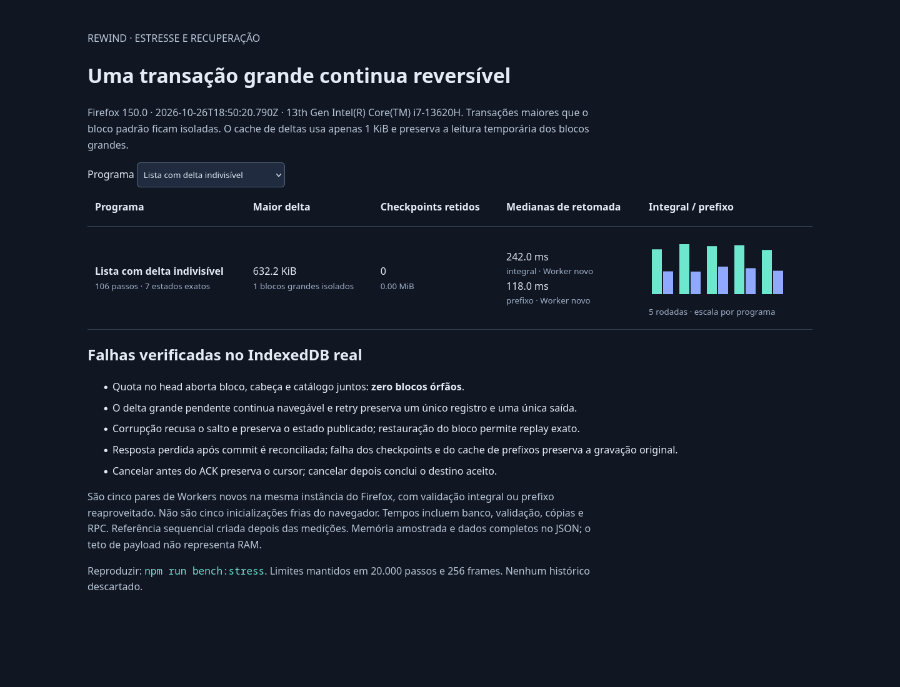

# Estresse de transações, checkpoints e recuperação

Este marco exercita estados maiores e deltas indivisíveis nos contratos atuais. A aplicação manteve os **20.000 passos**, 256 frames, formatos e quotas existentes; nenhum histórico foi descartado. Os testes não encontraram uma falha de reversibilidade nesses casos. A entrega acrescenta casos de regressão e medições reproduzíveis, sem mudar a VM.

- [Relatório visual independente](storage-stress.html), com filtro e cinco pares de retomadas por programa.
- [Dados completos](storage-stress-browser.json), incluindo amostras de processos e resultados das falhas.
- Casos compartilhados em `scripts/stress-fixtures.ts`, usados pelos testes e pelo Firefox.



## Executar

```bash
npm run bench:stress
```

O comando executa oito testes do núcleo e os ensaios no Firefox instalado. Gera `.artifacts/storage-stress-browser.json`, `.artifacts/storage-stress.html` e capturas. Usa perfil isolado dentro do projeto e as [portas/configurações do harness existente](../README.md#verificações); não instala componentes, não baixa navegadores e não usa o perfil pessoal. O ensaio é optativo, separado do smoke test comum. Os oito testes também fazem parte de `npm run check`.

## Casos e invariantes

| Caso | Pressão exercitada | Verificação |
| --- | --- | --- |
| Lista com 80 inteiros de 4.001 dígitos | `BUILD_LIST` remove operandos e aloca o heap no mesmo delta, maior que 512 KiB | Bloco isolado, desfazer/refazer recupera operandos, heap e IDs; aliases e ciclo posteriores permanecem exatos. |
| Função com 90 locais grandes | `RETURN` remove um frame de centenas de KiB | Voltar restaura o frame completo; avançar devolve o resultado ao chamador sem duplicar a chamada. |
| 400 saídas de 2.002 caracteres | Estado e snapshots crescem enquanto os checkpoints acumulam bytes | Redução dos checkpoints auxiliares dentro de 8 MiB, preservando todos os deltas, início e futuro. |

O journal usa buffer de **32 KiB** e cache retido de apenas **1 KiB**. Um bloco maior que o cache é lido temporariamente e validado, sem passar a ocupar o LRU inteiro. Isso não impõe um teto de 1 KiB para a RAM: estado, reservas, índice e bloco em leitura têm custos próprios. Deltas maiores que 256 KiB ocupam um bloco individual; não são partidos para simular uma transação menor.

O núcleo compara journal, retomada integral, biblioteca paginada e arquivo v2 com uma execução independente. Nos deltas grandes, verifica também o cursor imediatamente anterior/posterior nos dois sentidos. Spies garantem que o replay/retomada não chama o executor. Arquivos e capturas preservam os limites e a semântica v2/VM2.

O Firefox usa os clientes/Workers da aplicação e o IndexedDB real. Compara sete destinos únicos por caso grande e cinco no caso de saída com o estado completo da referência: controle, frames/locais, operandos, saída e heap. A referência é criada depois das fases medidas. Durante os saltos, o harness mantém alguns estados serializados para a comparação posterior; as amostras de processo incluem esse custo. Cada programa usa cinco pares de retomadas:

1. Worker novo e `validateAll: true`, conferindo todos os blocos originais.
2. Outro Worker novo, reaproveitando o prefixo validado e conferindo zero passos antigos.

São dez Workers por programa na mesma instância do navegador, com caches do sistema/engine possivelmente aquecidos. **Não representam cinco inicializações frias do Firefox.** Cada par verifica o mesmo estado completo e fronteira; medianas descrevem esse ambiente, sem promessa de tempo universal.

## Falhas testadas

- **Orçamento lógico antes do ACK:** com 2 MiB, a criação da lista grande é recusada sem publicar a alocação, alterar cursor/count ou perder os operandos. Prefixo anterior continua navegável e retomável.
- **Cancelar a instrução especulativa:** o callback de preparação cancela o `BUILD_LIST`; a VM recupera operandos, heap e contador de IDs. Uma nova tentativa aloca exatamente uma lista.
- **Pré-flush recusado:** falha ao salvar o buffer anterior abandona a instrução grande antes de sua aceitação. Estado/count/buffer e cabeça durável são preservados; retry pode aceitar uma única alocação.
- **Quota após aceitar um delta grande:** a escrita da cabeça falha depois de adicionar o bloco à transação do banco. O aborto preserva cabeça/catálogo anteriores e não deixa bloco órfão. O delta aceito permanece no buffer e pode ser desfeito/refeito. Retry adiciona um único bloco; saída final aparece uma vez.
- **Resposta perdida depois do commit:** a reconciliação pela revisão/hash reconhece o bloco grande já publicado, sem duplicá-lo.
- **Corrupção em bloco grande:** leitura inválida recusa o salto, preservando todo o estado/cursor mostrado; restaurar o bloco original permite replay exato.
- **Quota auxiliar:** falhas de checkpoints e do cache de prefixos não desfazem o commit primário. A retomada reconfere o histórico original e recupera o mesmo estado.
- **Cancelamento de salto antes/depois do ACK:** antes da aceitação conserva o estado anterior; depois conclui o destino aceito, inclusive quando o destino contém dados grandes.

Quota é injetada somente num Worker de teste e em bancos temporários. O ensaio não enche o disco. O núcleo usa `fake-indexeddb`; os ensaios de aborto/ausência de órfãos, corrupção e resposta perdida são repetidos no IndexedDB nativo. As bibliotecas/scripts do usuário permanecem separados e a preservação dos scripts é verificada no navegador.

## Resultado local

Firefox 150.0, Linux, i7-13620H, 16 CPUs disponíveis, servidor Vite de desenvolvimento, capturado em 26/10/2026:

| Caso | Passos | Maior delta¹ | Checkpoints retidos | Mediana integral² | Mediana com prefixo² |
| --- | ---: | ---: | ---: | ---: | ---: |
| Lista grande | 106 | 647.361 B | 0 | 242 ms | 118 ms |
| Retorno grande | 196 | 366.949 B | 1 / 253.947 B | 347 ms | 60 ms |
| Saída acumulada | 5.213 | 6.598 B | 20 / 8.070.014 B | 435 ms | 92 ms |

¹ Tamanho codificado do delta; o array do bloco acrescenta dois bytes nos casos isolados. ² Cinco amostras por modo; tempos incluem construção do Worker, RPC, codec, leitura/validação e restauração.

O maior RPC de gravação observado foi **211 ms** no caso de retorno. Ele inclui um lote de até 16 instruções e transporte; não isola o custo da instrução individual. O maior salto medido foi **66 ms**. Uma transação, serialização ou cópia individual continua indivisível, mesmo quando o loop usa lotes limitados. Isso merece atenção antes de prometer resposta ou cancelamento com prazo fixo em sessões maiores.

No caso de saída, a interface mostrou **800.800 caracteres**, voltou ao estado sem saída e restaurou o texto inteiro sem duplicações. Layout de **390 px** permaneceu sem transbordamento da página. A saída ainda é renderizada integralmente num painel com rolagem: este ensaio comprova restauração/layout, não um limite de custo para textos arbitrários.

RSS/PSS/memória privada estão no JSON pelo [mesmo amostrador de processos](resource-profile.md): árvore isolada do Firefox, varreduras sem sobreposição a pelo menos 150 ms e amostras nas bordas. Picos rápidos podem escapar; RSS soma páginas compartilhadas repetidamente, PSS divide essas páginas, e ambos incluem browser/JIT/GC/gráficos e o harness da página. O orçamento lógico não virou teto de RAM. Não há asserções frágeis de milissegundos/memória para máquinas arbitrárias.

## Próximo marco

Preparar limites de execução configuráveis com um contrato explícito de compatibilidade para journal, arquivos e capturas. Antes de liberá-los, dimensionar cotas de índices/estado e exercitar os novos limites com esta matriz de falhas e os testes gerados existentes. A política continua preservando o histórico completo: qualquer retenção parcial exigiria fronteira/checkpoint e indicação visível do primeiro cursor disponível.

Permanecem separados: medir boots realmente frios em ambientes adicionais, investigar alocações que escapam às amostras, limitar o custo de renderizar grandes saídas e validar Chromium/WebKit quando houver browsers de teste disponíveis. Não houve atualização de componentes do computador neste marco.
