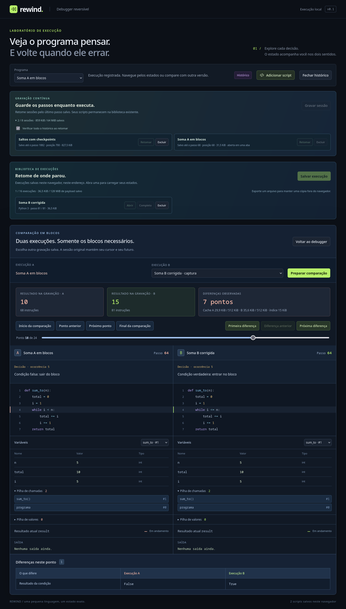

# Checkpoints graváveis e comparação em blocos

As sessões em **Gravar sessão** agora mantêm checkpoints intermediários em disco. Um salto escolhe o estado atual, a origem, a fronteira ou um checkpoint próximo, conforme o caminho mais curto. A tela informa o ponto de partida e quantos deltas foram aplicados no último salto. Todos os passos e o futuro continuam disponíveis.

**Comparar gravações** compara duas sessões/capturas já persistidas, usando leitores com cache limitado em um Worker. O alinhamento e as diferenças seguem as mesmas regras do comparador anterior; nenhum array completo de transações é transferido para a interface. **Comparar execuções** continua disponível para exemplos, scripts e históricos integralmente carregados.

## Experimentar

1. Escolha **Python · Soma com bug**, use **Gravar sessão**, nomeie **Soma A** e execute até o resultado `10`.
2. Troque para **Python · Soma corrigida**. A saída da sessão tenta salvar suas pendências antes de mudar o programa.
3. Grave como **Soma B** e execute até `15`.
4. Feche o histórico e use **Retomar** em **Soma A**. Navegue até um passo que queira preservar.
5. Clique em **Comparar gravações**, escolha **Soma B** e **Preparar comparação**.
6. **Primeira diferença** mostra a condição que encerra cedo a soma A. Navegue até o final ou volte; **Voltar ao debugger** recupera o cursor original de A.

Uma sessão contínua salva suas pendências antes de abrir esse comparador. Se essa escrita falhar, ela permanece aberta; o debugger completo permite resgatar/comparar o buffer ainda em memória. As duas gravações precisam usar a mesma linguagem e versão. É possível combinar uma sessão contínua com uma captura de **Salvar execução**.



## Checkpoints: dados derivados e limitados

O banco auxiliar **`rewind.recording-journal.seek-checkpoints` v1** tem catálogo de sessões, descritores leves e estados separados. Não altera o journal v1, os scripts nem o formato de exportação v2. Fonte/checkpoint são vinculados pelo ID da sessão, checksum da fonte, versão do validador, cursor e selo de uma borda de bloco. O conteúdo tem tamanho UTF-8 e SHA-256 verificados; a VM decodificada precisa caber na reserva de estado e passar pela validação estrutural.

O intervalo começa em **128 passos**. Após um commit durável, o estado da fronteira pode virar um checkpoint; buffers menores podem produzir bordas fora dos múltiplos exatos de 128. Há até **128 pontos / 8 MiB por sessão**, e **16 sessões / 64 MiB** nesse banco. Ao atingir a quota por sessão, o cache espaça os pontos, prioriza o mais recente e aumenta o intervalo. Quotas agregadas podem despejar checkpoints de outras sessões antigas. Nenhum delta original é removido.

A publicação de checkpoint/descritor/catálogo e os despejos são atômicos. Quota, versão incompatível ou falha auxiliar não desfazem o commit do programa. Checkpoint ausente ou corrompido permite tentar outro ponto ou restaurar pelos deltas; cancelar antes da confirmação mantém a VM publicada. A exclusão da sessão tenta limpar também seus checkpoints.

Esses checkpoints aceleram as sessões que os produziram. Um journal antigo sem pontos continua acessível pelos deltas e passa a produzir pontos ao continuar gravando. O cache de prefixos validados continua separado: acelera a conferência da retomada, enquanto este cache acelera os saltos.

## Comparação: projeção e restauração do par

`ComparisonProjection` extrai atribuições, decisões, chamadas, retornos, listas, saída e términos. Tanto o comparador integral quanto o paginado usam essa projeção e o mesmo alinhamento por contexto/comando/ocorrência. O paginado lê até **16 registros por lote**, valida/aplica em uma VM privada e conserva somente metadados semânticos. Depois percorre os pontos alinhados para calcular diferenças e a primeira divergência.

Os leitores de sessões contínuas são explicitamente de **somente leitura**: não assumem o escritor, não renovam sua lease, não criam passos, não salvam seu cursor e não liberam o escritor original. Cada leitor fixa uma cabeça durável, mesmo que outra aba venha a acrescentar passos. Capturas usam `PagedHistoryStore` e sua indexação existente.

Ao navegar, os cursores privados dos leitores podem avançar separadamente, mas o estado mostrado pertence a um par completo. A interface só confirma o par preparado para o pedido atual; o Worker publica ambos depois do ACK. Cancelamento antes do ACK, falha no segundo leitor ou substituição do destino preservam o par anterior mostrado. Um pedido já confirmado termina antes do próximo. A fila guarda um pedido ativo e somente o próximo destino mais recente.

Não há snapshot por ponto, nem fork integral do histórico. Cada lado usa cache de deltas de até **512 KiB** por padrão nesse comparador, reduzido conforme o orçamento disponível. Os metadados de pontos/contextos/alinhamento têm uma reserva própria, limitada pelo orçamento concedido pela página, de no máximo **64 MiB**. A reserva dos descritores de alinhamento é conservadora por linha; os pontos/contextos são contabilizados incrementalmente. Apenas cabeçalhos/índices são transferidos na preparação; os saltos enviam estados do par, diferenças, rótulos dos frames e métricas.

O orçamento agregado da página reserva espaço para leitores, índices e estados transferidos junto à sessão original. São estimativas de payload, não RAM: código compilado, strings compartilhadas, overhead do motor/DOM e serialização transitória têm custos adicionais. O índice cresce com os eventos, e a análise ainda visita todos os pontos. Paginação reduz a retenção de deltas, não elimina esse custo de preparação nem promete tempo constante.

## Testes e medidas

```bash
npm run check
npm run build
npm run bench:streaming -- --output .artifacts/streaming-benchmark.json
npm run test:firefox -- --streaming-only
npm run test:firefox
```

Os testes comparam cada ponto nos dois sentidos com o comparador integral, incluindo resultados 10/15, aliases 99/2, recursão, ciclos, erro e prefixos parciais. Verificam cancelamento antes da confirmação, falha do segundo leitor, limites de metadados, origem preservada, redução por quota, checkpoints ausentes/corrompidos e quota real de escrita simulada na API do IndexedDB.

No diagnóstico do Firefox, uma gravação de 1.882 passos saltou ao passo 700 partindo do checkpoint 640, aplicando somente 60 deltas. No benchmark do loop de 1.179 passos, chegar ao passo 589 exigiu 13 deltas com checkpoints, contra 589 sem eles. Programas curtos que ainda não atingiram o intervalo continuam usando origem/fronteira, sem benefício artificial atribuído ao cache.

O Firefox instalado usa IndexedDB/Workers de produção: checkpoints persistidos, estados completos de referência, comparação cruzada entre journal/captura, cancelamento antes/depois do ACK, saída do comparador mantendo a posição original e layout de 390 px. [Relatório do navegador](streaming-browser.json). [Benchmark reproduzível](streaming-benchmark.json) compara saltos com/sem checkpoints e navegação do comparador com referência integral. O benchmark usa fake-indexeddb; tempos não medem disco real. Heap/RSS são amostras do processo inteiro, incluindo Vite e banco emulado, sem isolar pico de RAM da VM.


Os limites continuam em **20.000 passos / 256 frames**. Comparar fontes ainda usa o comparador integral; gravações importadas devem ser salvas como captura para entrar no novo fluxo. Breakpoints e passos por comando nos modos contínuo/paginado foram implementados no [marco de controles unificados](paged-controls.md).
