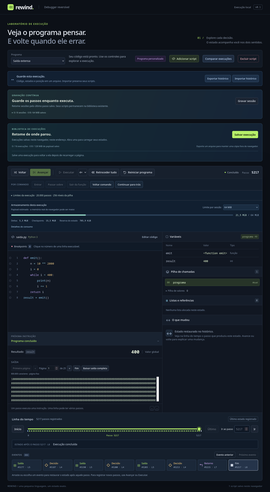

# Captura sequencial e saída paginada

**Abrir debugger completo** transfere uma gravação contínua para uma sessão integral. A captura agora percorre cada bloco uma vez, mesmo quando ele excede o cache de deltas. A saída extensa tem páginas e download completo nos modos clássico, contínuo, paginado e de comparação.



## Transferência com consumidor controlando o ritmo

Antes, cada pedido buscava até 16 registros pelo intervalo. Um bloco de 128 registros que não coubesse no LRU era lido e decodificado novamente para cada pedido. A nova operação `capture` usa `LiveRecording.streamRecords`: mantém somente o bloco em uso e entrega fatias de até 16 registros. O Worker aguarda `pull` depois que o builder privado consome a fatia; não acumula mensagens enquanto a interface está ocupada. `yieldControl`, quando fornecido pelo consumidor, também termina antes do próximo envio.

O bloco temporário passa pela mesma admissão/reserva de leitura existente. Não aumenta o cache retido nem os limites de execução, memória lógica ou disco. O limite de transporte é de **16 registros**, sem promessa de um teto fixo de bytes por mensagem: uma transação indivisível pode ser grande. A cópia do pacote via structured clone continua necessária. A sessão integral construída no destino também continua consumindo memória proporcional ao histórico.

A operação é serializada com navegação/escrita no Worker. Enquanto está ativa, inclui o prefixo durável e o futuro ainda no buffer, sem executar instruções ou modificar o cursor. O destino só é publicado após receber a quantidade esperada, validar todos os deltas e restaurar o cursor capturado. Cancelamento, erro de orçamento ou pedido substituto descartam o builder; o journal e o futuro da origem permanecem disponíveis. O iterador deixa de reter o bloco quando termina ou é abandonado. Reiniciar uma captura cancelada começa novamente no passo zero.

O protocolo de captura é interno, entre cliente e Worker da mesma aplicação. Formatos de arquivos, manifests, bancos, checkpoints e regras de preparação/ACK das operações que alteram estado permanecem compatíveis. `readRange` continua disponível para os leitores de comparação e a referência de benchmark.

## Saída completa, DOM limitado

`ProgramOutput` lê as entradas de `state.output` sem concatenar todo o texto em cada atualização. Se a saída couber em uma página, apresenta o texto como antes. Para saídas maiores oferece:

- Primeira página, anterior, número de página e próxima.
- **Fim**, que acompanha a última página conforme a execução avança ou retrocede.
- **Baixar saída completa**, que gera `saida.txt` com o texto do cursor atual.

Escolher uma página a mantém fixa; se o retrocesso reduzir a quantidade de páginas, a página exibida é ajustada à faixa disponível. A escolha volta a valer se o texto crescer novamente. Trocar o programa clássico reinicia a seleção. O navegador continua permitindo rolar e selecionar o texto da página.

A divisão usa offsets UTF-16, com até **32.769 unidades por painel**, ajustando a fronteira para não separar um par substituto de emoji. Não altera espaços, quebras de linha ou entradas da VM. A contagem exibida como caracteres segue `String.length`; não representa grafemas. Os testes também cobrem um par dividido entre entradas distintas de saída e um emoji final que ocupa a fronteira, sem criar uma página vazia.

O trabalho normal percorre os tamanhos das entradas e concatena apenas a página visível. Ainda depende da quantidade de entradas, limitada pela VM. A saída completa permanece na VM/deltas/checkpoints e nos snapshots enviados pelos Workers; essa entrega reduz o texto renderizado e sua concatenação, sem eliminar essas cópias. O download completo concatena o texto explicitamente e pode ter custo proporcional à saída total.

## Verificação e medidas

`tests/live-recording.test.ts` verifica uma leitura por bloco com cache de um byte, futuro pendente, restauração do cursor, replay sem executor, interrupção/cancelamento e nova tentativa. A matriz de estresse passa pelo mesmo stream com listas e retornos maiores que 256 KiB e saída acumulada de 800.800 caracteres. `tests/output-page.test.ts` reconstrói exatamente o texto a partir de todas as páginas, com casos gerados e Unicode.

O ensaio nativo usa o Firefox instalado, perfil isolado no projeto, IndexedDB real e Workers de produção. A referência anterior faz pedidos `range` de 16 registros e cede controle entre eles. A nova faz uma captura com confirmações de consumo. Ambas usam a mesma gravação de **50.000 passos**, cache de 16 KiB e o mesmo builder. O benchmark compara SHA-256 de todos os registros restaurados e verifica estados completos contra uma execução independente, criada depois das fases medidas.

Na rodada registrada com Firefox 150.0:

| Medida | Pedidos por intervalo | Captura sequencial |
| --- | ---: | ---: |
| Registros restaurados | 50.000 | 50.000 |
| Leituras de bloco | 3.125 | 391 |
| Pacotes de registros | 3.125 | 3.125 |
| Máximo de registros por pacote | 16 | 16 |
| Maior pacote codificado | 7.132 bytes | 7.132 bytes |
| Tempo da captura | 8.045 ms | 2.512 ms |

O stream reduziu aproximadamente 87,5% das leituras e 68,8% do tempo nesse caso. O cache retido ficou em zero: os blocos excediam os 16 KiB disponíveis. Foram conferidos 3.130 estados completos, além da igualdade de todos os registros entre capturas. Um consumidor suspenso recebeu apenas um pacote até autorizar a continuação; cancelar nessa pausa, cancelar após progresso, falhar por orçamento e substituir a captura por um salto preservaram a sessão original.

Os resultados desta entrega estão em [transfer-capture-browser.json](transfer-capture-browser.json). Os tempos incluem transporte, validação, serialização do instrumento e I/O, em Vite dev; são uma rodada pareada, com a referência executada primeiro na mesma instância do navegador. Não isolam CPU/disco, não medem inicialização fria ou pico de RAM e não constituem uma garantia de latência.

A verificação de [output-pagination-browser.json](output-pagination-browser.json) percorre as 25 páginas de 800.800 caracteres nos modos clássico, contínuo, comparação e materialização, reconstrói todo o texto e confere o Blob efetivamente produzido pelo botão de download. Também verifica início/fim da execução, replay, layout de 390 px e console sem erros. [Captura móvel](output-pagination-mobile.png).

```bash
npm run check
npm run build
npm run test:firefox -- --transfers-only
# Apenas os fluxos visuais de saída:
npm run test:firefox -- --output-only
# Regressão geral:
npm run test:firefox
```

Os relatórios gerados ficam em `.artifacts/`. Não há downloads de navegadores ou alterações em versões globais. Os limites ampliados e o contrato de leitura legada estão em [execution-limits.md](execution-limits.md).
