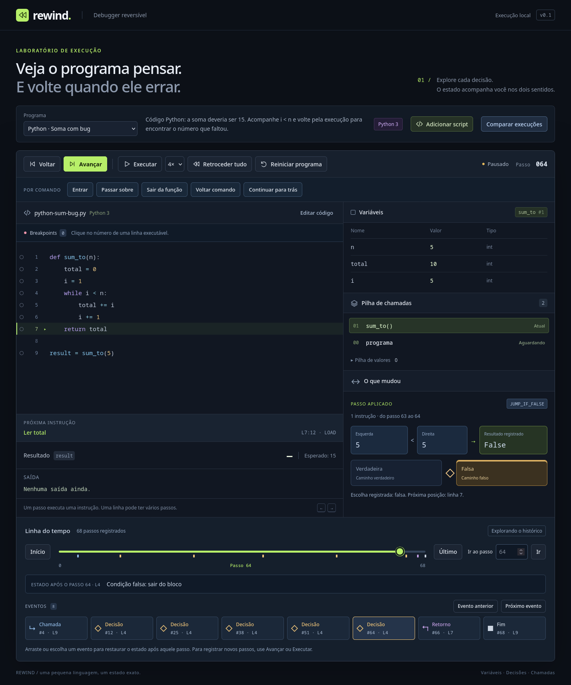

# Explicações visuais e escala

O painel **O que mudou** explica a instrução aplicada ou desfeita usando seus registros. A posição do debugger continua indicando a próxima instrução. Depois de um salto, o painel informa que o estado foi restaurado; avance ou volte uma instrução para observar uma mudança específica.



## Explorar o bug

1. Execute **Python · Soma com bug** até concluir com `10`.
2. Escolha a última **Decisão** na linha do tempo e clique em **Voltar**. O diagrama mostra os operandos `5` e `5`, o operador `<`, o resultado registrado `False` e o caminho falso, agora desfeito. A condição volta à pilha.
3. Volte mais uma instrução: o resultado da comparação sai e os dois operandos originais reaparecem. A seta aponta para eles. Avance duas vezes para reaplicar as mesmas mudanças.
4. Escolha o **Retorno** e volte uma instrução para restaurar `sum_to()` com `n = 5`, `total = 10` e `i = 5`. O diagrama distingue o chamador, o frame restaurado e o resultado retirado da pilha do chamador.
5. Experimente **Passar sobre**, **Sair da função** ou **Voltar comando**. O painel agrega as atribuições do intervalo por variável e ID de frame. As setas de **Registro** selecionam uma instrução desse intervalo sem mover o programa.

Leituras indicam nome e escopo de origem, incluindo bindings globais, parâmetros locais e builtins Python. Atribuições mostram presença e valores antes/depois; uma variável ausente permanece distinta de `None` ou zero. Saída e erros têm explicações próprias. Um erro atômico não apresenta alterações parciais já revertidas como se tivessem ocorrido.

## Evidências e contrato

`explainStep(program, history, index, direction)` e `summarizeNavigation(program, history, from, to)` são projeções independentes da UI em `src/core/explanations.ts`. Não chamam o executor ou operações matemáticas, não buscam uma posição da VM e não alteram estado, cursor ou histórico. Os índices representam a ordem de execução registrada, não os endereços do bytecode.

- **Matemática:** operandos removidos e resultado adicionado vêm dos deltas da pilha. A ordem esquerda/direita respeita a ordem dos pops da VM. Ao voltar, restauram-se os valores originais, sem calcular uma função inversa. `bigint`, `-0`, `NaN` e infinitos conservam seus tipos/valores.
- **Decisões:** a condição vem do pop registrado e o resultado vem do caminho registrado no controle posterior. Isso preserva a decisão histórica mesmo se uma lista mudou depois. A proveniência segue os índices dos splices de operandos para achar seu produtor. Mostra uma fórmula somente quando esse produtor é uma operação matemática/unária; igualdade entre valores não constitui proveniência. Curto-circuito pode mostrar apenas o valor usado na condição.
- **Leituras:** a origem é reconstruída até o registro selecionado, mantendo somente nomes de frames e presença de bindings. Não copia valores ou o estado completo. Isso funciona mesmo depois que a função retornou ou numa seleção de registro anterior ao estado atual.
- **Chamadas/retornos:** parâmetros e locais vêm dos frames preservados no delta. Ao desfazer um retorno, a UI mostra o frame restaurado; ao desfazer uma chamada, mostra sua remoção. Builtins não criam um frame artificial.
- **Listas:** alocações e splices guardam ID, índice e itens iniciais/removidos/adicionados. Ao voltar, mostram remoção da lista, item restaurado ou append desfeito. Valores que são referências ficam identificados por ID; não são expandidos usando um heap de outra posição.
- **Intervalos:** antes/depois seguem a ordem real da navegação. A tabela contabiliza escritas, inclusive em frames encerrados, identificando-os explicitamente. Não descreve essas variáveis como locais atuais. O foco inicial prioriza erro, retorno, decisão e chamada; o usuário pode escolher outra instrução.

As animações são CSS, sem sincronizar ou atrasar a VM. `prefers-reduced-motion: reduce` as desativa. Diagramas usam texto, setas e rótulos; a escolha também está expressa por escrito, sem depender somente da cor.

## Custo da interface

O painel principal monta até **24 variáveis por página**; atribuições de intervalos, até **12**. O resumo de um frame mostra 12 locais e indica os restantes, que podem ser consultados restaurando/selecionando o frame. Nenhum valor é descartado. O código mantém sua virtualização, e a linha do tempo mantém até oito cartões e 96 marcadores agregados.

`HistoryEventIndex` classifica apenas registros anexados. Replay não reclassifica instruções antigas; reinício ou substituição do histórico limpa a projeção. `firstEventAfter` procura o próximo evento por busca binária. Marcadores ainda são reagrupados quando o tamanho do histórico muda, porque suas posições relativas mudam.

Para reproduzir o diagnóstico do núcleo, sem instalar nada:

```bash
npm run bench:visual -- --output docs/visual-benchmark.json
```

Medição nesta máquina com Node 24.18.0, 100 amostras de busca/explicação após dez de aquecimento e 50 resumos completos. Gravação/índice usam lotes de 256. [Dados completos](visual-benchmark.json):

| Cenário | Passos | Gravar lote p95 | Seek p95 | Leitura tardia p95 | Decisão p95 | Resumo de todo o retrocesso p95 |
| --- | ---: | ---: | ---: | ---: | ---: | ---: |
| Loop, 2 locais | 19.509 | 1,946 ms | 0,036 ms | 1,090 ms | 0,004 ms | 6,744 ms |
| Loop, 2.502 locais | 18.009 | 2,973 ms | 0,688 ms | 1,516 ms | 0,004 ms | 6,743 ms |

O índice incremental apresentou p95 de **0,098 / 0,122 ms por lote**, contra **6,038 / 5,610 ms** ao reclassificar o histórico inteiro em cada lote. O índice armazena eventos, não snapshots. As leituras tardias e os resumos completos ainda têm custo linear; a busca depende de checkpoints e deltas locais.

O smoke test no Firefox 150.0 também executa uma função com 2.502 locais e loop de mil iterações. Na medição com movimento normal, gravou até o breakpoint em aproximadamente **1,47 s**, devolvendo controle entre lotes, e registrou **18.013 passos** após o retorno. Vinte saltos alternados início/último, incluindo dois `requestAnimationFrame` por amostra, levaram **24–50 ms**, com mediana de **34 ms**. Esses tempos incluem renderização e espera por frames, e não equivalem ao custo isolado de `seek`. [Medição do navegador](visual-browser.json).

```bash
npm run test:firefox
npm run test:firefox -- --reduced-motion
```

Os dois modos usam somente o perfil de teste no projeto. O teste verifica as animações efetivas, diagramas, seleção de registros sem mover o cursor, replay sem duplicar histórico, limites de DOM, paginação, restauração de milhares de locais, saltos grandes, console e layout de 390 px. Os fluxos Playwright têm os mesmos diagramas preparados para os engines configurados; Chromium/WebKit não foram executados nesta máquina.

**Decisão sobre Worker:** manter os lotes e checkpoints nos limites atuais. As medidas acima não indicam necessidade de mover a VM nesta entrega. São diagnósticos locais, não garantia para toda fonte/hardware; não medem heap e não cobrem todos os custos de compilação ou inteiros enormes. Antes de elevar limites, repetir casos representativos no navegador e medir tarefas síncronas; tarefas repetidas acima de 50 ms ou busca/explicação acima de 16 ms justificam reavaliar um Worker. Nesse caso, manter a VM/histórico nele, enviar projeções pequenas para a UI, numerar pedidos e cancelar respostas obsoletas ao trocar sessão.

## Próxima evolução do armazenamento

O envelope, codec, validação e quotas dessa proposta foram implementados no marco de [históricos portáveis](portable-histories.md), incluindo Worker para processar importações grandes. O histórico permanece separado da biblioteca de scripts e é reaberto por arquivo. Antes de aumentar limites ou admitir efeitos externos, ainda é necessário evoluir a retenção:

1. O marco de [listas reversíveis](reversible-lists.md) evoluiu o codec para v2 e rejeita v1 explicitamente. Semântica futura também exige versionamento e política de compatibilidade. Eventos e explicações continuam derivados.
2. Manter as garantias de valores especiais e validação da cadeia ao acrescentar estado. A impressão digital curta da comparação continua sem servir como verificação de identidade/integridade; o arquivo usa SHA-256.
3. O [orçamento por payload](storage-budget.md) já está separado da quantidade de passos: deltas, checkpoints e reserva do maior estado. Retornos, operandos e saída podem ser grandes; essas medidas continuam distintas do heap JS e de orçamento agregado da página.
4. Para retenção parcial, manter um checkpoint na fronteira e indicar o primeiro cursor ainda disponível. Nunca descartar silenciosamente o início e continuar prometendo retrocesso completo. Arquivo em blocos/IndexedDB exige controle de quota, carregamento cancelável e testes de corrupção/versão incompatível.

Continuam vigentes 20.000 passos por sessão, 256 frames e no máximo 128 checkpoints com espaçamento adaptativo. O heap de listas tem limites de 4.096 objetos/20.000 itens; outros objetos e closures exigem ampliar os deltas e testes. Efeitos externos exigem um contrato específico de gravação/replay.
